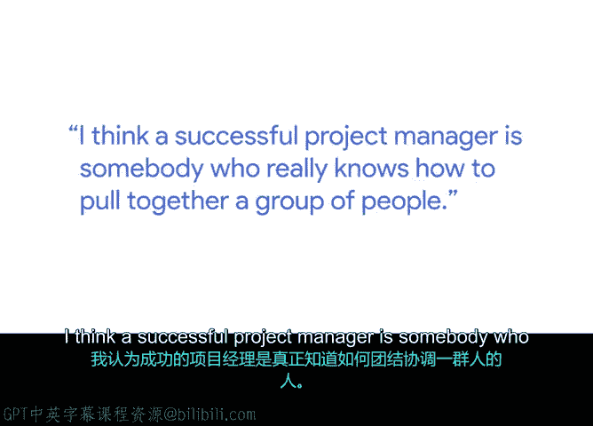

# 谷歌项目管理：专业证书 第1课：《项目管理基础课程（Google）》｜project-management-foundations｜ - P21：21_02_06_埃伦：成功项目经理的特质.zh_en - GPT中英字幕课程资源 - BV1nr4y1R7rb

I'm Ellen， and I'm a director of technical program management。

 And that means I lead a team of program managers at Google。

 I love project management because I really like this idea that you can do more together as a team with a group of people than you could do alone by bringing a bunch of people together and getting organized。

 getting aligned around a common goal we can do some pretty amazing things。

 I think a successful project manager is somebody who really knows how to pull together a group of people。

To me， there's really two parts of project management。

 One is is this laser like focus on executing on this goal， But then the other part is the people。

 And so a successful project manager can do both。 When I first started managing project managers。

 it was really about， you know everyone works on their own project。

 How do I just guide them give them guidance and help them with their projects over the years I've shifted to you know。

 to mentoring on project management to mentoring project managers。

 And what I mean by that is it it's different， I'm no longer saying here's what you should do on your project。

 I'm really trying to help them think about how to think about their projects。

 One of the things that I think about a lot as I'm building a project management team is having a really diverse set of folks who with different different backgrounds。

Different experiences。And， you know， we're a global company。

 so we're really trying to make sure we are a global team as well。And when I talk about diversity。

 of background and experience， like， it really is about， you know。

Working in different types of environments。With different。Types of teams， when I。

Chat with new project managers and they say like how， you know。

 how do I how do I continue to grow as a project manager。

 my answer is like work on different projects， right。Work on as many projects as you can。 But like。

 don't be afraid to try different different areas，  different domains。

 work with different people with every project you work on， you're going to really learn something。

