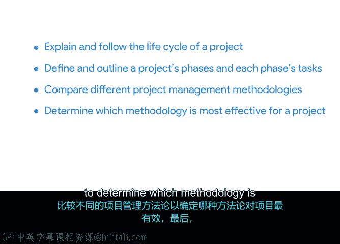

# 谷歌项目管理：专业证书 第1课：《项目管理基础课程（Google）》｜project-management-foundations｜ - P23：23_03_01_引言：项目管理生命周期与方法论.zh_en - GPT中英字幕课程资源 - BV1nr4y1R7rb

Welcome back Before we move on， let's recap what's already been covered。

 you learn how to define project management， what a project is， what it isn't。

 and how to explain its value to businesses。You also discussed when and why it's necessary to have a project manager。

 the role and day to day responsibilities of a project manager。

 and the core skills needed to be a successful project manager。

Now's a good time to stop and recognize how much you've learned。By now。

 you're familiar with the job of project management。

 and you've started learning what it takes to be an effective project manager。

Now you'll go a little further and learn some of the ins and outs of the job。 And before you know it。

 you'll be ready to guide any project successfully。 Are you ready。😊，Well coming up。

 I'll introduce you to the two most popular approaches to project management， waterfall and Agile。

 willll also cover the project management life cyclee and phases。

 and you'll learn about the different styles， scenarios and factors that can impact a project and its tasks at any given phase when we're done。

 you'll be able to explain and follow the life cycle of a project。

Define and outline a project's phases and each phases tasks。

 compare different project management methodologies to determine which methodology is most effective for a project and finally organize how a project is run according to different program management methodologies。

Ready， let's get started。