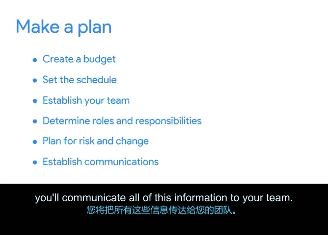

# 谷歌项目管理：专业证书 第1课：《项目管理基础课程（Google）》｜project-management-foundations｜ - P25：25_03_01_阶段实践：启动与规划.zh_en - GPT中英字幕课程资源 - BV1nr4y1R7rb

Now that we've discussed the project lifecycle， we're going to explore some of the different tasks that match up with each lifecycle phase。

But first。Let's review the phases。 The project life cyclee phases are， initiate the project。

Make a plan。Execute and complete tasks。And close out the project。Okay， great。

Let's get back to the tasks that need to be accomplished during each phase for this video。

 we're going to focus on the first two project life cyclee phases。

Initiating the project and making a plan。It's important to call out that the name or tasks for each phase might change or may be a little different depending on the type of project or the organization where you work。

At Google， we use a mix of different project management methods。

 which you'll learn more about later in the course。But regardless of the method。

 all projects share a lot of the same tasks needed to get the job done。So let's get into it。

The first step of the project life cyclee is to initiate the project。During initiation。

 you'll organize all of the information you have available to you about your project。This way。

When you're ready to continue on， you'll be prepared for the next phase when you can create your plan。

Defining project goals makes the details of your project clear so that you and your team can successfully complete the project。

For example。If the project goal is to manage a political campaign， then some deliverables。

 which are specific tasks or outcomes， might be to raise $5000 or get $500 signatures in support of your candidate's cause with this in mind。

 you'll need to do some research to come up with ideas that will help you meet your goals。

 You'll also need to find out what resources are available。Resources can include people， equipment。

 software programs， vendors， physical space or locations， and more。

Anything you need to actually complete the project is considered a resource。Now。

 as a project manager， you'll record all of these details in your project proposal and then get them approved by a decision maker or group of decision makers at your company so that you can move ahead with your project plans。

Now， in some cases， you may be the decision maker， so be sure to consider the same set of factors when initiating your project before moving to the next stage。

No worries， you will learn all the details about how to create a project proposal。

 we will be getting into more detail of what this is and how to create one later in the course。

Vila once your project is approved， you'll move into the second step of the project lifecycle。

 which is to make a plan。In this phase， you'll create a budget。And set the project schedule。

 You'll establish the project team。And determine each person's roles and responsibilities。

Let's pause for a second。 You may be thinking， why can't we just get started。

 but that's the thing with project management。 Dever planning is critical to a project success。

 A crucial part of project management is planning for risk and change。

 An experienced project manager knows that plans always change。😊。

This ability to adapt is all about thinking and planning ahead。 scheduling delays， budget changes。

 technology and software requirements， legal issues。

 quality control and access to resources are just some of the more common types of risks and changes that a project manager needs to consider。

So it's important to keep in mind that planning is key to reducing those risks。But don't worry。

 if the idea of risks seems a little overwhelming right now， in later courses。

 we'll teach you all about understanding risks。 Just know that it's really important not to skip this step and to always make a plan。

 Again， the success of your project depends on it。Once you have a plan。

 you'll communicate all of this information to your team。

That way， each member will know which tasks they'll own and what to do if they have questions or if they run into problems。

You'll also communicate your plan with others who have an interest in the project's success so that they are aware of your plans and your progress as the project continues to move forward。

Nice job。 We've made it halfway through the steps of a project life cycle。 Up next。

 we'll check out the remaining two phases， executing and completing tasks and closing the project。

 Cattch in a bit。😊。