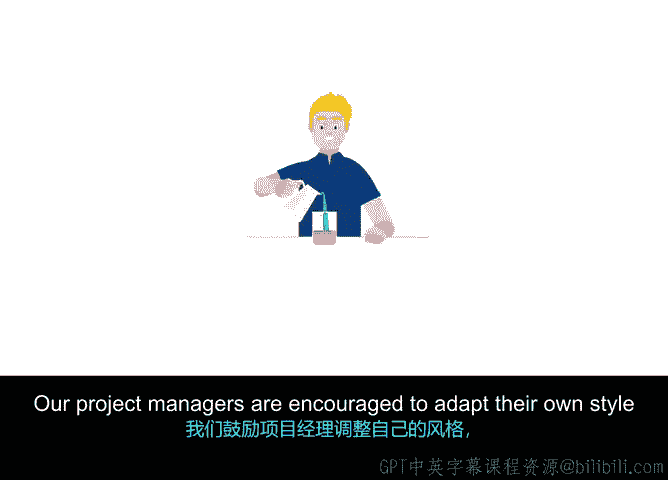

# 谷歌项目管理：专业证书 第1课：《项目管理基础课程（Google）》｜project-management-foundations｜ - P27：27_03_01_项目管理方法论介绍.zh_en - GPT中英字幕课程资源 - BV1nr4y1R7rb

Welcome back。 As we've already discussed， not all projects are like。

Different types of projects will benefit from applying different project management approaches or methodologies。

 A project management methodology is a set of guiding principles and processes for owning a project through its life cycle。

Project management methodologies help guide project managers throughout a project with steps to take tasks to complete and principles for managing the project Overall。

 We will talk through two different types， linear and iterative。

Linear means the previous phase or task has to be completed before the next can start。

A linear approach would work well for a project likeBuild a house。

 you'd need the blueprint created before you can begin laying the foundation。

You've got to know exactly what the house will look like， its dimensions。

And what type and how many resources you'll need。 Then you've got to finish the foundation before you put up the walls and the walls before you put up the roof and so on。

 before you have the finished project， which is a bungalow style home。There's also a clear goal。

 you know exactly what the house will look like。 it's unlikely that in the middle of building the house。

 your client is going to decide they'd rather have a multilevel Victorian instead of a single level bungalow。

What's more， even if they wanted the change？It's too late。

 You already laid the foundation and built the walls for the bungalow。Done and done。

 A bungalow is what they wanted and a bungalow is what they'll get。

 using this type of linear project management approach。

 completing each step in order and sticking to the agreed upon specific results and being able to deliver just what the client ordered for a project like producing a new show for a television company。

 on the other hand。😊，It might be more effective to use a methodology that uses an iterative。

 more flexible approach where some of the phases and tasks will overlap or happen at the same time that other tasks are being worked on。

Your team comes up with an idea for a show and films a pilot。

You are on several tests of the pilot in different locations and time slots。

As your team gathers feedback about the pilot， adjustments to the show are made。 At the same time。

 you're able to make decisions and start working on other parts of the project。😊。

Like hiring permanent actors， starting film production and working on advertising。

 even while the final version of the show is being worked on。

And even though the overall goal is clear。Produce a new show。

The type of show could end up being different from the original idea。

Your team may have started out creating a one hour show， but during testing。

 they realized a half hour show would actually be more popular。

Or maybe a supporting character got a lot of positive feedback。

 so you want to make them one of the main characters。

What's more important is that you produce a show that audiences are going to watch。

Because of the iterative approach， plans remain flexible and you're able to make adjustments as you go along。

Each of these projects benefits from a different approach to how tasks will be carried out in order to best meet the project's goals。

 Linear projects don't require many changes during development and have a clear， sequential process。

If you stick to the plan， it's likely you'll finish your tasks within the time schedule and all other criteria。

Iterative projects allow for more flexibility and anticipate changes。

 You're able to test out parts of the project to make sure they work before the final result is delivered。

 and you can deliver parts of the project as they are completed rather than waiting for the entire project to be done。

😊，Over the years， the field of project management has developed many different methods that project managers can choose from that will help them manage most effectively。

 Google takes a hybrid approach to project management。😊。

We mix and match from different methods depending on the type of project。

Our project managers are encouraged to adapt their own style to what makes the most sense to their project and their team。

So are you starting to see how different approaches might benefit the projects you'll be working on now。

 pretty soon you'll become a pro at picking an approach or combining approaches to fit with your project。

Up next， we'll learn about the most well known and most used project management methods that you can add to your project management toolbox。

