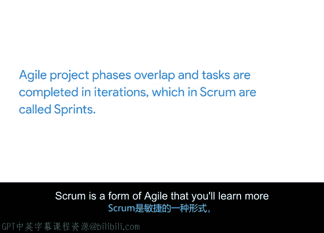

# 谷歌项目管理：专业证书 第1课：《项目管理基础课程（Google）》｜project-management-foundations｜ - P28：28_03_02_瀑布与敏捷方法概述.zh_en - GPT中英字幕课程资源 - BV1nr4y1R7rb

Two of the most popular project management methodologies are waterfall and agile。

 Each of these methods has a rich and complex history。 In fact。

 you could take an entire certificate on just one of these methods alone。

You'll have a chance to learn more about waterfall and agile methods in the upcoming courses of this certificate。

 So be sure to check those out after completing this one to learn more For now。

 I'll just give you a brief introduction and provide you with some examples that illustrate how different types of projects can be more successful or easier to manage when you consider which method to use。

😊，First， let's take a look at the waterfall approach。

 Waterfall as a methodology was created in the 70s and refers to the sequential ordering of phases。

 You complete one at a time down the line like a waterfall。

 starting at the top of a mountain and traveling to the bottom。

Remember the definition and example of linear from that last video， well。

 waterfall has a linear approach。At first， waterfall was used in the physical engineering disciplines like manufacturing and construction。

Then software emerged as an important field of engineering and waterfall was applied to those kinds of projects as well。

It's still used a lot in engineering fields， including product feature design and application。

 also known as app design。Over time， other industries like event planning and retail。

 have adapted waterfall phases to fit their projects。There are now many styles of waterfall。

 and each style has its own specific set of steps。 What they all have in common， though。

 is that they follow an ordered set of steps that are directly linked to clearly defined expectations。

 resources and goals that are not likely to change。 Let's take a closer look。

 The phases of a waterfall project life cycle follow the same standard project life cyclee flow that you learned about earlier。

 initiating， planning， executing， which includes managing and completing tasks and closing。

So when would you want to use a waterfall approach to project management， Well。

 when the phases of the project are clearly defined or when there are tasks to complete before another can begin or when changes to the project are very expensive to implement once its started。

For example， if you were catering an event for a client on a very tight budget。

 you might want to use waterfall methodology。This way， you could confirm the number of guests first。

Then very clearly define the menu。Get approval and agreement on the menu items and costs。

Order the unreturnable ingredients。And successfully feed the guests。Because the budget is limited。

 you can't afford to make changes or waste food。 The traditional method won't allow for the client to make changes to the menu once the order has been placed。

You can also reserve tables， chairs， and dishes because you know exactly how much and what kind of food is being prepared。

 a well thought out traditional approach to managing a project can help you reach your desired outcome with as little pain as possible during the project implementation。

By spending extra effort thinking through the entire project up front。

You'll set yourself up for success。Now， in an ideal world。

 following this approach will help you identify the right people and tasks。

 plan accordingly to avoid any hiccups along the way。

 create room for documenting your plans in progress and enable you to hit that goal。However。

 plans don't always go， well， according to plan， in fact， they rarely do。

 the waterfall method has some risk management practices to help avoid and deal with project changes。

Luckily， there are other methodologies that are entirely built for change and flexibility。

 One of these is agile。 another popular project management approach。

The termAgile means being able to move quickly and easily。It also refers to flexibility。

 which means being willing and able to change and adapt projects that use an agile approach often have many tasks being worked on at the same time or in various stages of completion。

 which makes it an iterative approach。The concepts that shaped agile methodology began to emerge in the 90s as a response to the growing demand for faster delivery of products。

 mainly software applications at that time。 But it wasn't officially named Agile until 2001。

 the phases of an agile project also followed the project life cycle stages we described earlier。

 General speaking。 However， rather than having to always go in order or wait for one phase to end before starting the next。

Agile project phases overlap， and tasks are completed in iterations。

 which in Scrum are called sprints。Scrum is a form of agile that you'll learn more about in the course focused entirely on agile。

 and by sprint， we do not mean running a race as fast as possible。

In this case， Spprint are short chunks of time， usually one to four weeks。

 where a team works together to focus on completing specific tasks。

What's important to understand is that agile is more of a mindset than just a series of steps or phases。

It's concerned with building an effective collaborative team that seeks regular feedback from the client so that they can deliver the best value as quickly as possible and adjust as changes emerge。

Projects that are best suited for an agile approach are those where the client has an idea of what they want。

 but doesn't have a concrete picture in mind， or they have a set of qualities they'd like to see in the end result。

But aren't as concerned with exactly what it looks like。

Another indicator that a project may benefit from agile is the level of high uncertainty and risk involved with the project。

We'll talk more about those things later。An example of a project that would work well with an agile approach might be building a website。

 Your team would build the different parts of the website and sprints and deliver each part to the client as they are built。

 This way， the website can be launched with some parts。

 Sa the main homeage that are complete and ready for public view。

 While other parts maybe the company blog or the ability to book online appointments。

 continue to get built out over time。 This allows the team to get feedback early on about what works and what doesn't。

 make adjustments along the way。 and reduce wasted efforts。In this same website example。

 the waterfall method will plan for and require the whole website to be complete before it can launch。

Having a basic understanding of waterfall and agile will help you figure out an effective way to organize and plan out your project。

And knowing about these two methodologies will come in handy during future job interviews。

 because you'll be able to demonstrate a solid understanding of the project management landscape。

Waterfall and agile are two of the more common and well known project management methodologies。

 but they are by no means the only or the best ones。 And the next videos。

 you'll learn about leanan Six Sigma， another way to approach projects。Here at Google。

 believe it or not， we select from many of these methodologies for project management。

