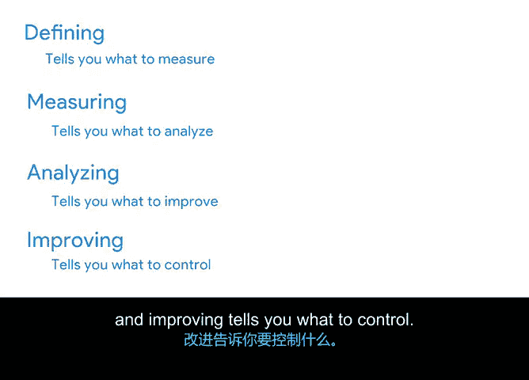

# 谷歌项目管理：专业证书 第1课：《项目管理基础课程（Google）》｜project-management-foundations｜ - P29：29_03_04_精益与六西格玛介绍.zh_en - GPT中英字幕课程资源 - BV1nr4y1R7rb

Hegan， now you've got waterfall and agile methodologies in your project manager toolbox。

 leanan 6 Sigma is one more you can add。 It's a combination of two parent methodologies。

 lean and6 Sigma。 The uses for leanan 6 Sigma are common in projects that have goals to save money。

 improve quality and move through processes quickly。😊，It also focuses on team collaboration。

 which promotes a positive work environment。The idea is that when your team feels valued。

 motivation and productivity increases， and the whole process functions more smoothly。

There are five phases in the leanan Six Sigma approach， they are defined。Measure， analyze， improve。

And control， commonly known as DMAIC。DMAIC is a strategy for process improvement。

 meaning you're trying to figure out where the problems are in the current process and fix them so that everything runs more smoothly。

The goal of each step is to ensure the best possible results for your project。

Just like with waterfall and agile， there are more specific details for using DMAIC and the Lan Six Sigma approach。

But what's great about the DMAIC process is that it can be used to solve any business problem。

 Let's break it down。 The first phase is to define the project goal and what it will take to meet it。

 This first phase is very similar to the initiation phase of traditional project management。

 Let's take a real scenario to illustrate， Imagine that you are brought on as a project manager for a large travel company to help streamline and minimize customer service wait times that have been surging due to a recent sales promotion。

😊，Before you begin working on tackling the issue， you're going to need to define the project goal and talk to stakeholders about expectations for the project。

In this case， the goal is to take average wait times down to less than 10 minutes on average compared to 30 minutes。

Next， it's time to measure how the current process is performing。In order to improve processes。

 DMAIC focuses on data。Here you want to map out the current process and locate exactly where the problems are and what kind of effect the problems have on the process。

Using our example， you're trying to figure out why it's taking so long for the travel company to address a customer service issue。

To do this， you look at company data like average wait times， number of customers per day。

 and seasonal variations。Then you'll set a plan for how you'll get that data and how often to measure it。

This could look something like having the company generate reports on a weekly， monthly。

 quarterly basis。In other situations， you might have employees or customers fill out surveys or look at inventory shipping and tracking records。

 things like that。Once you have the data and measurements， you can move on to the next phase。

 which is analyze。Here you'll begin to identify gaps and issues In our example。

 after mapping out the process and data points， you may see that staffing is inadequate on days where customers are the highest。

 data analysis is important for project managers regardless of which method you choose。

 and we will learn more about that in an upcoming course。From your data。

 you'll have a strong understanding of causes and solutions to get to the next stage， improve。

Oftentimes， project managers may want to leap straight to this phase。

 but really projects and process improvements should only be made after a careful analysis This is the point where you present your findings and get ready to start making improvements。

In our example， this could be modifying staffing to address customer needs。

The last step of this cycle is control。You've gotten the process and project to a good place。

 and now it's time to implement it and keep it there。

 Controling is all about learning from the work you did up front to put new processes and documentation in place。

And continue to monitor so the company doesn't revert back to the old。

 inefficient way of doing things。To sum it all up， you can remember DMAIC like this。

Defining tells you what to measure。Measuring tells you what to analyze。

Analyzing tells you what to improve and improving tells you what to control。

Lean Six Sigma and the DMAIC approach are ideal when the project goal includes improving a current process to fix complex or high risk problems。

 like improving sales conversions or eliminating a bottleneck。

Which is when things get backed up during a process。

Following the DMAIC process prevents the likelihood of skipping important steps and increases the chances of a successful project。

And as a way for your team to discover best practices that your client can use going forward。

It uses data and focuses on the customer or end user to solve problems in a way that builds on previous learning so that you can discover effective。

 permanent solutions for difficult problems。There are many ways out there that break the flow of project management into digestible phases and approaches。

 all with the same end goal of accomplishing the desired outcome as smoothly as possible and delivering the best value。

Like I said earlier， at Google， we follow a lot of different approaches。 For instance。

 an engineering team releasing a customer focused product may primarily use agile when creating the product。

 but decide to plug in some of the aspects of waterfall project management for planning and documentation。

A customer service team might focus on using Lean 6 Sigma to improve an experience for our users。

 like offering new features based on a recent analysis。

 but the team might develop parts of the code and roll out the features using agile iterations and sprints to allow for change。

Or one of our internal education and training teams may focus solely on waterfall project management to achieve a targeted goal of having all employees complete an annual compliance training。

Here。Waterfall makes sense since the requirements of the training program are fixed。

 and so is the deadline and goal。The biggest takeaway is to know the various methods and tools to be able to confidently apply what works best for you。

Your team。And the end goal。There is no real prescription for how to execute a project perfectly because there are always pieces you can't 100% control。

 but the good news is you can get pretty close with the skill sets you developed through learning about these different frameworks。

