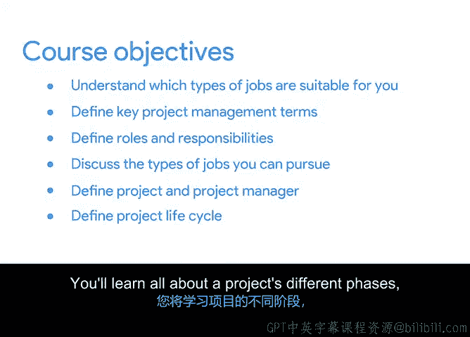

# 谷歌项目管理：专业证书 第1课：《项目管理基础课程（Google）》｜project-management-foundations｜ - P2：02_01_03_课程一介绍.zh_en - GPT中英字幕课程资源 - BV1nr4y1R7rb

So far， we've previewed what you can expect throughout this program。In this video。

 we'll discuss the details of this course and you'll have a greater understanding for which types of jobs are suitable for learners like you。

We'll cover some key project management terms and the roles and responsibilities of any entry level project manager plus。

 we'll discuss the kinds of jobs you can pursue after you complete this program。

One thing you'll learn soon is that there's other roles and jobs outside of just project manager that this program will prepare you for。

Later in this course， we'll have a video on how to search for those roles and how to view project management as both a position and a skill。

 But for now， we'll start by going even deeper into what a project is。

 what a project manager is and what kinds of skills they have will provide real life examples to help illustrate that you probably already have learned some of the skills required to become a successful project manager。

Then you'll learn more about adding value to projects and tips on being a successful project manager from Real life Googlers。

Pretty exciting， right？ We'll also cover the project's life cycle。

 You'll learn all about a project's different phases。 The corresponding tasks in each phase。

 different methodologies for completing tasks。😊。

🎼And which is effective for a given project。 And finally。

You'll learn about different types of organizational structures and cultures。

And how they impact project management。🎼Coming up， we'll start exploring the concept of a project and the project management field as a whole。

 Are you ready to crank things up a notch。 See you soon。😊。

