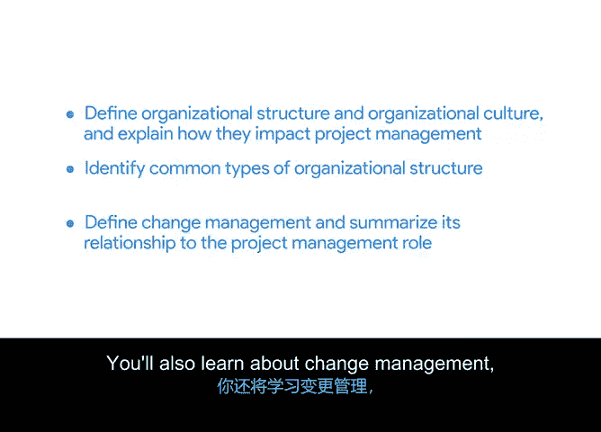

# 谷歌项目管理：专业证书 第1课：《项目管理基础课程（Google）》｜project-management-foundations｜ - P31：31_04_01_引言：组织结构与文化.zh_en - GPT中英字幕课程资源 - BV1nr4y1R7rb

Hey there， how are you feeling so far？We're nearing the end of this course and honestly。

 you've done a great job。Previously， we talked about the life cycle of a project。

 the task breakdown of phases， and some different methodologies you can use as a project manager to help ensure share your project success。

You also heard from my colleagues about some of the ways we manage projects at Google。Here。

 you'll learn about organizational structure and culture and how they impact the way you set up and execute your project。

I'll describe some common types of structures that you're likely to encounter during your project management career。

 you'll also learn about change management which refers to the way you present the final project to the organization and get them to accept and implement your project outcome。

These are important elements to ensure that your project is adopted and lives on Are you ready？

Let's get into these concepts。