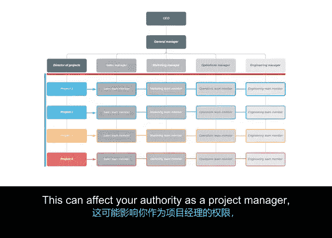

# 谷歌项目管理：专业证书 第1课：《项目管理基础课程（Google）》｜project-management-foundations｜ - P33：33_04_04_组织结构如何影响项目管理.zh_en - GPT中英字幕课程资源 - BV1nr4y1R7rb

He again， ready to keep going， the previous videos explained that knowing what kind of organizational structure you're working in plays a major role in how you prepare for and carry out your project。

An organization' structure provides the framework for accountability and communication。

As the project manager， it's vital that you understand who you're reporting to on each project。

And just as importantly， who the members of your team report to。

Knowing the organizational structure also tells you how and where to get the resources you'll need so you can get the project done efficiently。

When you understand the organization's structure， you'll be able to identify how it impacts the way you manage the project。

One way organizational structure can impact the way you manage a project is by the amount of authority given to the project manager。

Authority has to do with your ability to make decisions for the project that impact the organization。

In some cases， you might have the authority to do things like select the vendors who provide services or goods for the project。

Other times， you might have a set of vendors selected for you。

Your level of authority and responsibility will vary from project to project。

Another way organizational structures can impact project management is through resource availability。

Managing a project is a lot easier when you know how to access the people， equipment。

 and budget that you need。Let's explore how different structures can affect the way you manage a project。

In a classic structure， you might find yourself with less authority and a tighterco。

You may need to rely on getting approval from the appropriate managers， directors。

 and department heads in order to move forward and complete certain tasks。In this case。

 it's likely that these people are in charge of the people on your team and the resources you need。

As a project manager working in a classic structure。

 you may depend on the managers in your organization to approve resources， in other words。

 the amount of people working on your project or the budget that you have allocated to your project is decided by the leaders of your department or function。

In a classic structure， you may have to go through a chain of approvals and advocate for more resources if you need them。

 For example， if you need a budget increase， you would report this to your manager。

Then your manager might escalate this up to their management chain to get approval。

 That's the classic structure， a traditional top down arrangement of employees and authority。Now。

 let's explore the matrix structure。The main difference with a matrix structure is that employees often have two or more managers or leaders。

 they'll need to work with an update。 Your team members will have their functional manager and you。

 the project manager。 If members are working on multiple projects。 They may have even more managers。

 This can affect your authority as a project manager。

 as you will need to cooperate with more than one leader in the organization。

 you may need to share resources and negotiate priorities。 the key is to make sure。

 you know who your stakeholders are and who controls what since the chain of command isn't always as clearly defined as in the classic structure。

 because there isn't always a clear chain of command in a matrix structure。

 you need to make sure you have identified and communicated with anyone you might need to report to and get approval from well before the project begins。

Once this is established， though， your project within a matrix structure should be able to run efficiently。

Matrix structures emphasize a strong project focus from the team and the organization。

 so you as the project manager， generally have more autonomy to make decisions and gather resources as needed。

As I hope you've noticed， the way an organization is structured can have a big impact on the planning and execution of your project。

Understanding all of this will help you run and manage a project much more efficiently。Next。

 I'll tell you about organizational culture， another factor that impacts how you manage your project。

 catch you in a bit。