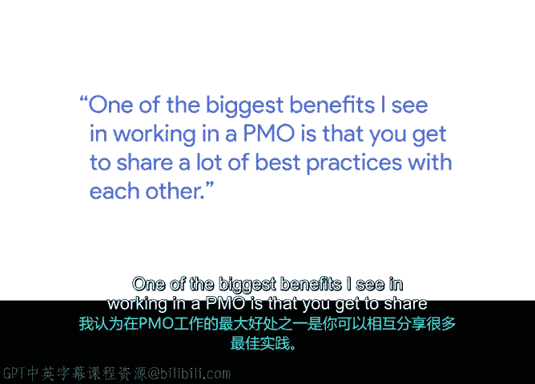
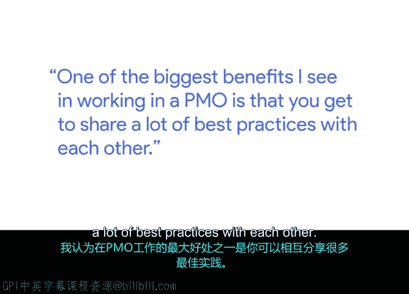

# 谷歌项目管理：专业证书 第1课：《项目管理基础课程（Google）》｜project-management-foundations｜ - P34：34_04_06_兰：在项目管理办公室工作.zh_en - GPT中英字幕课程资源 - BV1nr4y1R7rb

Hi， I'm Lawn。 I'm a director of program management at Google。

 A program management director has a team of project managers to help execute and bring products to our users。

 I work on the project management team or the PMO team for a group called Geo。 And in GeO。

 we bring geospatial products to our users， things like Google Maps and Google Earth。

 and the team that I am a part of actually works on all of the data and imagery that powers all of those products。

 A project management office is a team of project managers。

 We are a group that coordinates all of the different parts of a project together。

 including folks who work on our product， Engines and many business functions。

 and we help bring all of those ideas to life。😊，My role specifically in working in a PM O is ensuring that we' are connecting all of the different parts that are associated with projects to ensure that they're all connected together。

 Sometimes we find out when projects are happening。

 there's a piece of it here and a piece of it there， and they may not even know about each other。

 One of the most critical things that project managers get to do is they get to have a bird's eye view of everything that's happening in a project。

So that's a lot of my role And what I'm working on with my team is ensuring that all of the pieces that need to connect together actually do connect together。

 I've had many different roles inside of many different PMmos inside my career all the way from taking just a piece of part of a project when I was really early on my career and then expanded that into taking a full endto end project。

 which were smaller。 And then building up my career and then moving into really large complex projects。

 And at each stage of these， I had loved every piece of it。

 So even from the time that I had only a part of a project。

 I got to go really deep inside of some of those technologies and have really deep and meaningful relationships with the teams that I have been working with。

 And that's not always possible when you're working on a really large project that has hundreds of people。

 you won't be able to develop deep relationships across that large group。😊，On the flip side。

 when you're working on a large complex project， you get to see all of the different gears turning inside of a large ecosystem of things that are happening。

 but that took a long time in my career to build up， but at each phase of it。

 I realize I was learning a little bit more。 and I was learning how to work a little bit more broadly and think a little bit more differently。

 but really ensuring how do you continue to keep the execution and rigor of a project to ensure that ideas were coming to life。

 One of the biggest benefits I see in working in a PMO is that you get to share a lot of best practices with each other。

 One of the downsides， I think for project management is typically we don't get to work with each other。

 because we're working with a lot of client teams and we're working with other disciplines。

 but a huge benefit in working in a PMO is that you get to connect with other project managers。

 where you can share your challenges and see how somebody else had gotten through it。

 or you can share templates or tools that you may take time to develop on your own。

 but somebody already has handy。😊。

you can borrow or just steal their tool for your own use。

 but the best part is you have a community of people who think the same way about problems in a very methodical。

 in a very task oriented， in a very action oriented and goal- oriented way。

 which is not typically true if you're working across all other disciplines all the time。

