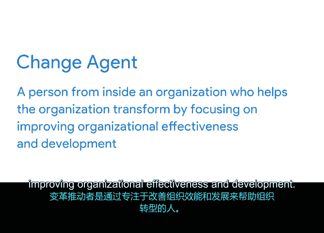

# 谷歌项目管理：专业证书 第1课：《项目管理基础课程（Google）》｜project-management-foundations｜ - P35：35_04_01_组织文化介绍.zh_en - GPT中英字幕课程资源 - BV1nr4y1R7rb

He again， let's begin with two quick questions， what do you know about culture？

And how do you define culture？When I hear the term culture。

 the first things that come to mind are things like languages， food， clothing， and types of dress。

It's important to note that there are other maybe less obvious。

 but just as impactful parts of culture， like beliefs， traditions and customs。

 When we learn about someone's culture， we gain a much deeper insight and more complete picture into who they are and how they navigate the world。

The same can be true for organizations。An organization's culture provides context and acts as a guide for what their people value。

 how they operate on a daily basis， how they relate to one another and how they can be expected to perform。

 There are many ways to define organizational culture。

 Some definitions emphasize teamwork and innovation。

 While others focus on attention to detail and achievement。 En thesis papers。

 workshops and conferences are dedicated to defining and analyzing organizational culture。

We only have a few minutes here， So I'll do my best to sum it up。 Oral culture is， in part。

 the values employees share， as well as the organization's values， mission， history and so on。

 In other words， organizational culture can be thought of as the company's personality。

Understanding an organization's culture will help you navigate your team more effectively toward achieving the project's goal。

It also impacts the way you plan your project。 You'll need to be familiar with an organization's culture so that you can minimize conflict and complete the project with as much support and harmony as possible。

 An organization's mission and values can provide clues to its culture。

If you can demonstrate how the project supports the company's mission or how the project aligns with the company's values。

 you'll have more support from executives and stakeholders to get the approvals and resources you need。

 Pay attention to what leaders in the organization value when conducting business。

 Does the management team care about speed over perfection。

 How do people within the organization make decisions。

 Do they thoroughly examine every option for every decision。

This will help inform which values are the most important to them and how you can approach your decision making。

If you're ever stuck in your project and need guidance about making a certain decision or are unsure how to communicate with someone in the organization。

Reviewing the mission and values may help direct you toward the right way to handle that situation。

Here's an example。 If the company values stability and user feedback。

 it might encourage expanding the project timeline to allow for testing and then making decisions based on those testing results。

If the company values innovation and revenue growth。

It might encourage a shorter timeline to get the product out faster and taking some risks to try out new ideas。

As a project manager， when you understand the different types of values and what to prioritize。

 you'll have an idea of how you can better prepare for conversations within the organization。

 Ideally， you'll want to have a good sense of an organization's culture before you start the first phase of your project。

If you are interviewing for a project management position。

 asking about the culture is a great way to get more information about the company。

It also shows the interviewer that you're knowledgeable about the impact culture can have on a project to help you gain a better sense of an organization's culture。

 consider the following questions。How do people prefer to communicate is it primarily through scheduled meetings？

Via email， over the phone， how are decisions made， Major vote or top down approvals。

 What kinds of rituals are in place when someone new comes to the office。

 Are they taken out to lunch， given a tour of the building or introduced to the staff。

 How are projects typically run， Do they prefer a classic。

 Do they prefer matrix or some other style of project management， And finally。

 what kinds of practices， Bes and values are reflected by the people in the organization。

Is overtime or weekend work and expectation？Are there companies sanctioned social events？

Finding out what the company values will tell you a lot about the culture and how to handle communication。

 manage expectations， and identify potential conflicts as you work through your project。

Once you begin working on a project， here are some ways to navigate company culture that will help you get the most out of your team and ensure that your project is supported。

 As I just discussed， make sure to ask questions。As you observe the culture。

 try asking your peers what they think is going well and what they would change。

 Your peers may have the same opinion as you。 And if not。

 you may learn something new you didn't learn in the interview process。 Either way。

 you'll be in a better place to assess risk， adjust your current project or be more prepared for projects in the future。

 It's also a good idea to make observations。 It's important to understand how things work and what people like and respect about the company's culture。

 when working in different geographies， It's also important to be aware of establish customs like bowing。

 shaking hands or wearing head coverings。 This will help you gain understanding and form respectful relationships。

 Lastly。It's important to understand your impact。 Be aware of your role as a change agent。

 A change agent is someone who helps the organization transform by focusing on improving organizational effectiveness and development。

You and your project will most likely affect the organization in some way。

Sometimes just the presence of a project manager creates changes in the office environment or employee dynamics。

If your project requires major changes that the organization must adapt to。

Be mindful of how extreme those changes could be and seek feedback and approval early on。

 The company may not agree with certain kinds of changes that don't seem to fall in line with their mission。

 vision or culture。It's important to recognize the limits or boundaries of changes to implement and understand what would be the most beneficial for the project and the company overall。

 As you can see， organizational culture has a strong influence over how decisions are made about the project。

The way an organization is structured usually influence the type of culture that exists。

So it's important to consider both structure and culture when planning and carrying out your project。

Coming up， we'll talk about the way your project can create change in the workplace and how to get stakeholders and employees on board with implementing your project。

