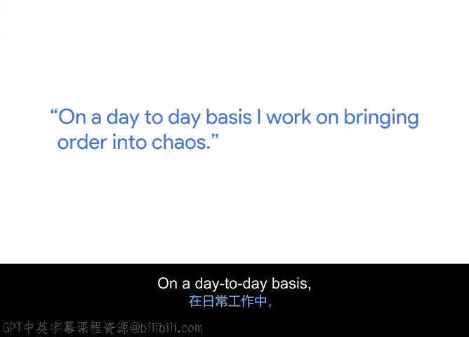
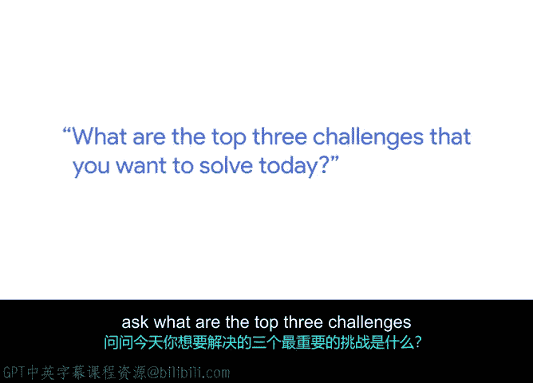

# 谷歌项目管理：专业证书 第1课：《项目管理基础课程（Google）》｜project-management-foundations｜ - P36：36_04_03_阿马尔：生活与组织中的项目管理.zh_en - GPT中英字幕课程资源 - BV1nr4y1R7rb

Hi， I'm Ammer。 I' am a senior engineering program manager at Google shopping。

 and on a day to day basis， I drive programs which spans across multiple products at Google。

 The way I look at program management， It's more like life is program management， right。

 Everything in life is programme， having kids， building a house。😊，Buying car， everything we do。

 there's a start and end kind of deal and what we see across the board in anything and everything we do there's a tremendous amount of like friction in the system in the decision making in the budgeting everything in life right and that goes that applies equally to software program management or even if you are in a construction industry if you see right from starting the construction project to really getting the beds and all the stuff right there's a tremendous amount of chaos from the perspective of that okay you know what are the right people connected are the right decision making people in the in the meeting are there right number of like approvals that we have in a timely basis So there are many of these things that I had witnessed during my career and previous companies and even at Google that those were not efficient and those were really adding a huge。

or exposing the risk late in the development cycle and that is what kind of I had seen as a chaotic world and I really felt that you know what I can really help out in solving some of those chaos on a day to day basis I work on bringing order into chaos。

Theres chaotic world out there in their software program development。 So we， as a program manager。

 make sure that we bring that together。 When I started my program management journey。

 One of the main thing， what I was looking for。 and thanks to the mentors， You know。

 I really cherish the mentors。 One of the thing they taught me that， you know what， Ammer。

 when you are coming to work every day， ask what are the top three challenges that you want to solve today。

And to date I follow， I always follow the thing about what are the top three things that I want to address today。

 big ones， impactful ones， as well as I also look at and also help my team understand on a weekly basis how success looks like every Monday morning I'll have meeting with strategic folks very strategic discussions on how the success looks like in this week。

 how would we define the week is successful and that is how I start my week it work miracles in the program delivery and or in life So I love those aspects。

