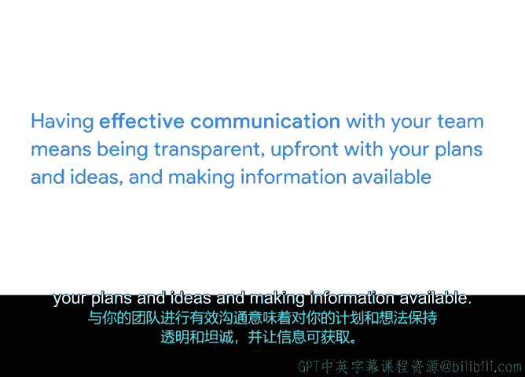

# 谷歌项目管理：专业证书 第1课：《项目管理基础课程（Google）》｜project-management-foundations｜ - P37：37_04_01_变革管理介绍.zh_en - GPT中英字幕课程资源 - BV1nr4y1R7rb

Welcome back。 Let's talk about change management。Sometimes the deliverable of a project is a new tool or new process that must be adopted by the organization。

 You've just learned that understanding organizational structure and culture will help you plan for and manage your project。

It will also help you roll out changes from your project to an organization in project management。

 the process of delivering your completed project and getting people to adopt it is called change management understanding change management can ensure that a project is completed successfully and that the organization accepts and adopts the recommendations from the project。

 For example， if you were launching a new time tracking system for employees。

 the project wouldn't be successful if the employees didn't adopt the new system。

When you understand change management and your role in the process。

 it can ensure a smooth roll out of changes and easier adoption。

 Adoption is often the first step to your project having the desired impact once it goes live。

 So let's get started。As a new project manager， you may not be responsible for planning all of the required change management for your project。

 But regardless， you can help the success of the project by understanding your role in the process and how your organization may react to that change。

 It's important to recognize that it's the people in an organization who are directly impacted by any changes in the workplace。

 Impleing a new project can mean changes the processes， budgets。

 schedules and employee roles and responsibilities。 Even aesthetic changes like building a new wing。

 Renovating the lobby or switching to a new company logo means employees will have to adjust to something new and different。

 Something as simple as adding a new logo can lead to a major headache for the employees who have to swap out all the old stationary and make sure everyone in the office is using the new logo correctly。

 When you consider the success of your project。 It's important to keep in mind the changes that people will need to implement as a result。

そう？Thinking through these changes will set you up for success in getting your project accepted and adopted。

 There are many change management models and strategies and a quick internet search will provide you with more explanations and examples than you will probably ever need。

While we have additional readings on change management coming up。

 feel free to read on any articles on the topic from well respected project management organizations to keep learning。

 though there are lots of different models， they all share the same general concepts。

Change management in project management is centered around three core concepts and best practices。

 The first core concept is creating a sense of ownership and urgency around the project。

 ownershipwnship means getting others to feel like they are empowered to take responsibility for the successful completion of their tasks。

 urgency means getting them to understand that the project is important and to identify what actions need to be taken to move the project along。

When team members feel a sense of ownership and urgency around a project， it increases interest。

 motivation and engagement with the project outcome。

 Another core concept is to figure out the right combination of skills and personalities when selecting the people who will work on your team。

😊，Find people whose knowledge and skills complement one another。 If your team is selected for you。

 see if you're able to choose who gets assigned which tasks， and if that's not possible。

Then it's extra important for you to find ways to connect with your team。

 This will get them excited about the project so then they can be advocates for change when it's needed。

 One effective way of motivating your team is to communicate clearly your vision and approach for the project。

😊，Then you can share how you see everyone working together as a team to make it happen。

Communicating this idea clearly allows others to share in your vision and take ownership in bringing it to life。

The final core concept is that ever important one， effective communication。

 and I can't stress this enough。 Communication is key。

 Having effective communication with your team means being transparent and upfront with your plans and ideas and making information available。

😊。

Make sure your team， along with the rest of the organization。

 is kept up to date on your progress this will allow everyone to feel like they are included in part of the project。

Once your project is complete， you may experience some resistance or a few roadblocks。 Remember。

 change doesn't happen overnight， so don't give up on it yet。 If you do get some pushback。

 you can move the process along by helping folks adjust， rewarding their efforts。

And reminding them of the overall value the project is providing long term。

Understanding the change process can help you determine how you can support a successful response to your project。

 for example。Understanding the importance of communication will help you be mindful of clearly communicating project plans to your team。

 as well as communicating the expected impact of the project with the rest of the organization。

Remember learning about agile project management。Well。

 since it's a popular methodology that you will probably use at some point。

 I wanted to point out that many of the principles of agile project management align with successful change management。

 How might an agile team approach change management， you ask， Well。

 being receptive to change is a core value in agile teams。

 So you will often find that they are in a state of evolution or are constantly adapting to change。

If this seems like a lot to remember， no stress。We'll continue learning more about these concepts throughout the course。

 Just know， as the project manager， you can enact effective change management approaches in all of your interactions。

In the next video， we'll discuss the differences between managing and participating in the process。

 See you soon。