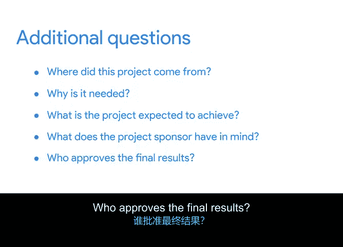
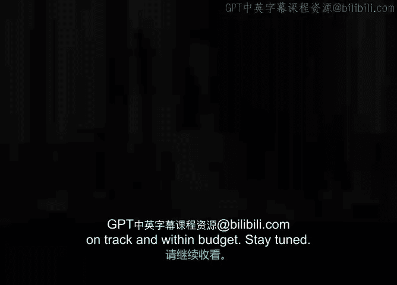

# 谷歌项目管理：专业证书 第2课：《项目启动：成功启动项目》｜project-initiation-google｜ - P10：10_02_01_确定项目范围.zh_en - GPT中英字幕课程资源 - BV14h4y1D7Hr

Welcome back。Project scope is a really important concept that I want to tell you about。

You'll hear it come up time and time again throughout each phase of the project life cycle。In fact。

 you may even find yourself defending it。So let's get acquainted with scope。In this video。

 you will learn how to define and determine scope。 Simply put your project scope includes the boundaries of a project。

The way we define it equiable is an agreed upon understanding as to what is included or excluded from a project。

Scope helps ensure that your project is clearly defined and mapped out。

That means knowing exactly who the project will be delivered to and who will be using the end result of the project。

You also need a firm understanding of the project's complexity。

Ass is straightforward with an easily manageable list of tasks。Or will it require extensive research。

 multiple rounds of approvals and a large scale production process that will take years to complete。

Scope also includes the project timeline， budget and resources。

You'll need to clearly define these so that you can make sure you're working within those boundaries and what's actually possible for the project to work。

Poorly defined scope or major changes to your scope can cause changes to the budget。

 timeline or even final outcome of the project。Let's look at the scope of your office screen project as an example。

As a reminder， the new plant P Service offers customers small。

 low maintenance plants like cacti and leafy ferns that they can place on their desks。

Customers can order them online or from a print catalog。

 An office screen will ship the plant straight to the customer's work address。

Things to consider for your scope， then。Might be whether or not to provide replacement plants。

Which customer segments will be offered the service。Whether or not the online catalog is an app。

 a website， or both。And how to ensure customers can purchase from the online catalog。

 whether by phone， PC， Mac， iPhone or Android。You might also consider the dimensions of the paper catalog and whether it needs to be in color or black and white and on what kind of paper。

Now， how do you actually figure out the scope of your project？It's simple。Talk to you。

 sponsors and stakeholders。Understand what their goals are and find out what is。

 and this is really important what is not included in the project。

We've covered a number of different ways to help you determine scope。

Here are a few more helpful questions to add to the list。Where did the project come from。

 Why is it needed。What is the project expected to achieve。What does the project sponsor have in mind。

Who approves to final no results。

Now， you really be set。As for timing， defining project Sculpia happen during the initial planning stage。

You want to start figuring out the scope early on so that everyone can agree to the same set of expectations。

It will help mitigate the rest of big changes down the line。

Although you can always adjust the scope as planning continues， if you need to。

Once you understand your project scope， you want to document all the details so that anyone can refer back to it throughout the life cycle of the project。

We'll talk about some best practices for that at the end of this module。Let's recap。

A clearly defined scope describes all the details of a project and regulates what can be added or removed as it progresses。

While it's ultimately the project manager's responsibility to monitor the project and make sure all the work and resources fall within its scope。

Team members and stakeholders can be encouraged to do their part by focusing on the tasks that are the most important to reaching the project goal。

The next video talks about the concepts of in scope and out of scope。

 And the phenomenon call scope creep。All three will help with ensuring your project stays on track and within budget。

Stay tuned。

