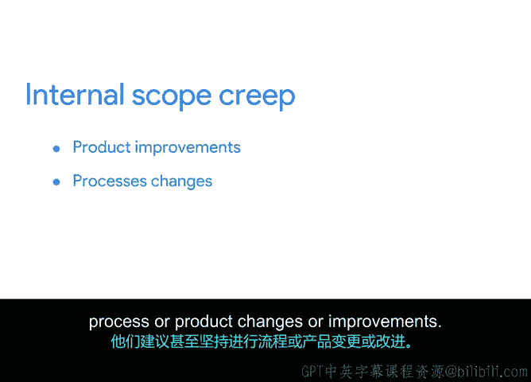

# 谷歌项目管理：专业证书 第2课：《项目启动：成功启动项目》｜project-initiation-google｜ - P11：11_02_03_项目范围的监控与维护.zh_en - GPT中英字幕课程资源 - BV14h4y1D7Hr

Hi there。 As you now know， an important part of project management is keeping an eye on your project scope and knowing which tasks are truly part of the plan and which aren't。

Tasks that are included in the project and contribute to the project's overall goal are considered to be in scope。

Tasks that aren't included are called out of scope。

It's your job as a project manager to set and maintain firm boundaries for your project so that your team can stay on track。

For example， if the copywriter or designers of the plant P catalog came up with the idea to expand the type of plans being offered to top customers。

 you would have to point out that their suggestion is out of scope and would take extra time and add to your budget costs。

As you progress through the project life cycle， you're going to encounter unexpected challenges or have new details or ideas brought to your attention that could impact your project's success。

Changes， growth and uncontrolled factors that affect a project scope at any point after the project begins are referred to as scope creep。

Scope creep is a common problem， and it's not always easy to control。

It's one that we struggle with on every single project。It can happen on any project， in any industry。

Imagine your working in a tech company， and your project involves working with designers and engineers to update the language icon's design on a mobile keyboard app for a smartphone。

 While the team is making the update， they realize that the search icon and the voice input icon also need a design refresh。

These are very small features。 And while technically not in scope。

 the team feels it would take minimalable effort and provide lots of value。

 So they go ahead and make the updates。During a stakeholder review。

 it's pointed out that there is a keyboard in English， but no keyboards for other languages。

And the suggestion is made to design additional keyboards。At this point。

 the project scope is in danger of expanding from a fairly simple icon update to a complex roll up of multiple keyboard layouts。

Adding the keyboards would impact the team's timeline， causing the project to take longer to finish。

 It would also impact resourcing because you would need to hire more people or existing team members would have to work over time。

And it would increase the budget since the team did not anticipate cost for extra working hours or keyboard translations。

This is just one example of scope Creek。Sometimes it's subtle， just design one or two more icons。

Or more obvious。 Hey， can you tack on design and keyboards for other languages。

By identifying scopepe creep and being proactive， you protect your project and your project team。

To help you combat scope creep， it's good to know that there are two major sources from which she comes external and internal external sources of scope creep are easier to recognize。

😊，For example， if you're working on a project with one main customer。

The customer might request changes。Or the business environment around you might shift。

 or the underlying technology you're using might change。

While you can't control everything that happens， there are some useful tips to keep in mind。First。

Make sure the stakeholders have visibility into the project。

You want them to know the details of what's going to be produced。What resources are required。

 how much it will cost and how much time it'll take。Also。

 get clarity on the requirements and ask for constructive criticism of the initial product proposal。

It's important to get this information before any contracts are signed。

 Be sure to set ground rules and expectations for stakeholder involvement once the project gets started。

Come to an agreement on each of your roles and responsibilities during execution and status reviews。

Once you're clear on the project scope， come up with a plan for how to deal with out of scope requests。

Agree on who can make formal change requests and how those requests will be evaluated。

 accepted and performed。And finally， be sure to get these agreements in writing。 this way。

 you always have a documentation to point to if you， a stakeholder or the customer。

 have a disagreement down the line。 One of the leading causes of external scope creep is not being clear on the requirements before defining the scope and getting formal approval to move forward with the project。

This is where those specific immeasurable goals and deliverables come into play。

If the requirements aren't specific。 And if you haven't agreed on the project's processes。

 deliverables and milestones， then you're almost guaranteed to be dealing with scopepe creep once the project begins。

 internalnal sources of scope creep are trickier to spot and harder to control。

This kind of creep comes from members of the project team who suggest or even insists on process or product changes or improvements。

It's possible that a product developer will justify a decision on the grounds of making the product better。

Even though it's going to cost more。Or a team lead might decide that a certain process is more efficient without realizing the impact the change in process will have on other team members tasked with different parts of the project。

What you need to make clearer to your team is that any change outside of the project scope comes off the bottom line。

 threatens the schedule and increases risk。There are no small impacts to project scope。

Anytime a team member takes on an unplanned task。More is loss than just the time spent working on that task。

 It's your responsibility as the project manager to maintain the limits of the project。

 The best defense is to know the details of your project in and out。

 So you always prepared with the most appropriate response to a new idea or request。 Let's recap。

Monitor your project scope and protect it at all costs。

Even the most minor change can mean majorous to your project's success。 Coming up。

 I'll tell you about the triple constraint model and how you can use it to help determine how your project changes affects scope。

Stay tuned。