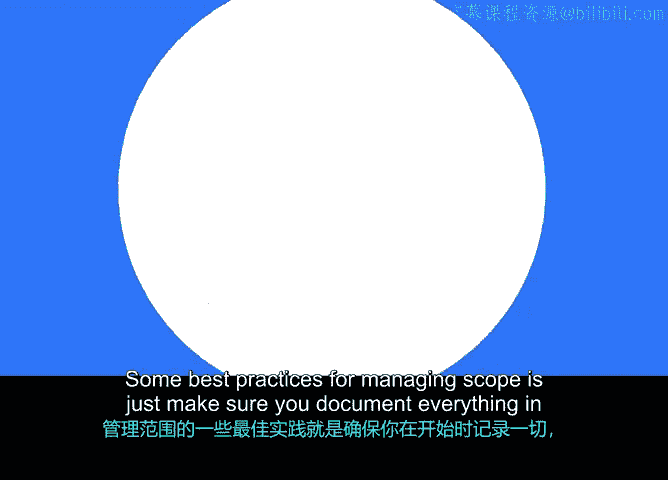

# 谷歌项目管理：专业证书 第2课：《项目启动：成功启动项目》｜project-initiation-google｜ - P13：13_02_06_托丽-保持范围界定的重要性.zh_en - GPT中英字幕课程资源 - BV14h4y1D7Hr

Hi， I'm Tory， and I'm an education program manager at Google。

 specifically I work on our digital literacy curriculum called Applied Digital S that helps learners of all ages learn the practical digital skills needed for the jobs of today and tomorrow。

 So scope is important because if you have a welldefined scope in the beginning of a project It'll help make sure that your team members。

 your stakeholders are all aligned and on the same page right from the start。

 and you can avoid any issues down the line that may come up that you might not have been aware of Some challenges of staying within scopepe could be what we like to call scope creep。

 and these things can happen if， for example， you have some stakeholders that have some certain needs。

 desires or requests that may actually end up changing the scope。

 Spe creep is when the scope changes after you've already started the project。

And this can be really challenging to manage if you don't keep an eye in it from the beginning。

 I was recently working on a project where we were hoping to actually reach underserved communities with our digital literacy curriculum and the initial project scope started off。

 focusing on middle and high school students。 But at some point down the line after the project started。

 there were some stakeholders who actually wanted to expand the audience to adult learners。

 And so we had some trouble， trying to figure out how we were going to manage that。

 where we going to change the scope where we going to keep it the same。 And ultimately。

 we decided to keep the scope the same and referenced back to our original goal in the beginning。

 because if you think about it， changing the audience would make the project goals and our strategies for reaching those audiences drastically different。

 So ultimately， we ended up keeping the scope and communicating that to our stakeholders。

 Some best practices for managing scope is just make sure you document everything in the beginning and share it with all of your。

😊。

and team members and make sure everybody's in agreement on that scope。

There are times where the scope may need to change， and that's okay。

 but you have to be able to make sure that you can also change and potentially change your timeline。

 your resources， or even the budget to accommodate that scope change。

