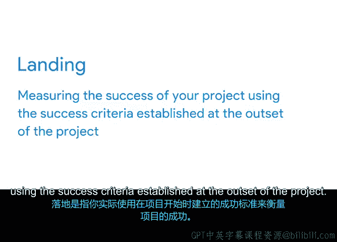

# 谷歌项目管理：专业证书 第2课：《项目启动：成功启动项目》｜project-initiation-google｜ - P14：14_02_01_项目的启动与落地.zh_en - GPT中英字幕课程资源 - BV14h4y1D7Hr

Welcome back。 At this point， you've learned a bit about setting smart goals。

 along with defining and managing the scope。It may be tempting to think that you're ready to kick off this project with these two important pieces。

 but there is one common element that ensures you'll achieve these goals within scope。

And that key element is knowing when your project is delivered， and you can call it a success。

Many people think the time to decide if a project is successful is when you've produced a final outcome and presented it to the client。

That's getting close， delivering the final result of your project to the client or user。

 It's what's called a project launch。You've finished building or creating a project。

 The tasks are completed， and the deliverables are done。 You've hit your goal。

 The project is successful and consider complete， in that sense。But does it work well？

Did it achieve your desired outcome。The real deciding factor of project success is when you put the final outcome to the test。

Landing is when you actually measure the success of your project。

 using the success criteria established at the outset of the project。

This is a crucial part of goal setting that is often overlooked in the initiation phase。For example。

Think about taking a trip on an airplane。It's not enough for the pilot to be able to get the plane off the ground。

To arrive safely at your destination， they've got to know how to land。

Your success has to continue beyond the point of delivering the final project。

You need to be able to measure whether the project functions as intended once it's put into practice。

Let's take the example of your project plant pal。You've managed to launch the new service with success。

The website has launched。 The catalogs have been printed and delivered。 Orders have been received。

 and revenue is starting to go up。It would be easy to call this a win， and move on。

But what happens if the customers are unhappy once the plants are delivered。

What if the plants start to wilt and this color after a couple of weeks。

Just because launching the project and getting it out the door looks like success on paper。

That doesn't mean the project has managed to land for most projects。

 a launch itself isn't a meaningful measure of success。

It's what comes after the launch that really counts。 Launes are only a means to an end。

 And looking beyond the launch is important to ensure the launch achieves your overall goals。

If you start off looking beyond the launch to the landing。

You're more likely to get where you're trying to go。

Since landing is a concept and not a finite definition。

It's important to define what a successful landing looks like for a particular project。Luckily。

 we have a way to measure and help you ensure the success of your project。

It's called success criteria。And if you can manage to follow it through the life cycle of your project。

You ultimately have a smooth landing。The success criteria includes all the specific details of your goals and deliverables。

And it can be a guide so you know whether you've accomplished what you set out to do。

Success criteria will set standards for how your project will be judged。In the next video。

 I'll outline what you need to know about defining success criteria and communicating project success。

See you in a bit。