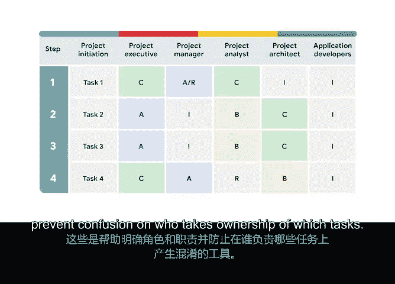

# 谷歌项目管理：专业证书 第2课：《项目启动：成功启动项目》｜project-initiation-google｜ - P17：17_03_01_引言-与利益相关者高效协作.zh_en - GPT中英字幕课程资源 - BV14h4y1D7Hr

Welcome back and this module will'll learn all about stakeholders and their importance to a project。

And the last set of videos， you learn the ins and outs of Project scope。

While exploring how a project can be in scope or out of scope， you learned about setting smart goals。

We also discussed launching a project， getting it started versus landing a project。

 whether or not it was successful。And there are a lot more exciting topics to come。In this module。

 you'll learn more about stakeholders。Remember that stakeholders play a pivotal role。

They are people who are interested in and affected by the project's completion and success。

You'll see that each person involved has a set role and set responsibilities to help bring the project to a landing。

 Those roles include project sponsors， customers， team members。 And， of course， you。

 the project manager。You'll also find out about things like stakeholder mapping and analysis and Racy charts。

These are tools that help clarify roles and responsibilities and prevent confusion on who takes ownership of which tasks。

Throughout this module， youll have plenty of hands on activities， discussion prompts。

 and readings to really help you master how to start a project。As we go through each new skill。

 imagine checking off a to do list， there's almost nothing more satisfying than crossing off a to do。

