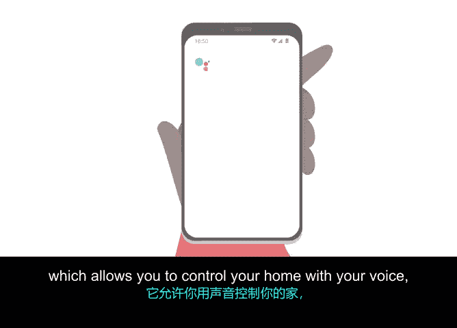

# 谷歌项目管理：专业证书 第2课：《项目启动：成功启动项目》｜project-initiation-google｜ - P18：18_03_02_项目经理的可访问性要求.zh_en - GPT中英字幕课程资源 - BV14h4y1D7Hr

Hello， nice to meet you。😊，My name is Holly， and I will be your accessibility instructor for this course。

 Accessibility should be incorporated into every role at a company， whether a product designer。

 communicator， developer， or yes， project manager。😊。

In my role of accessibility education program manager at Google。

 I help ensure all Googlers are educated on accessibility from building accessible products for the entire world to communicating accessibility with you throughout this course。

 I'm deaf for myself。 So I am able to share my experiences as a person with a disability， too。

 and help others understand that having a disability isn't a barrier in itself。

 It's the world around us that we must strive to make accessible for everyone。😊。

Accessibility can be defined a number of different ways。 To me。

 it means actively removing any barriers that might prevent persons with disabilities from being able to access technology。

 information or experiences and leveling in the playing field。

 so everyone has an equal chance of enjoying life and being successful。😊。

A disability is often defined as a physical or mental condition that substantially limits a major life activity such as walking。

 talking， seeing， hearing or learning。Over 1 billion people in the world have a disability，1 billion。

Thus， more than the population of the United States， Canada， France， Italy， Japan。

 Mexico and Brazil combined disability is diverse and intersectional。

 someone one can be born with a condition or acquire it later in life。

 disability can affect us all in some way， whether directly or indirectly， And at any time。

 from permanent， like deafness to temporary， like a broken leg to situational。

 like trying to operate a TV remote control in the dark。

When you create solutions for persons with disabilities。

 you are not only serving the critical audience of people with permanent disabilities。

 You are also unlocking secondary benefits for everyone who may move in and out of disability over time as you progress through this course is also important to keep in mind to your fellow classmates。

 Setting the expectation that you'll be interacting with others that learn and work differently is a key strength of working with accessibility in mind。

 Asking others what they need from you to learn and communicate and also sharing what you need if you have a disability yourself is important to working well together as a team。

😊，In project management， you yourself， people on your project team or people highly invested in your project may have a disability。

 whether visible or invisible As a project manager。

 you are responsible for making sure a group of people can come together to achieve a common goal using shared tools and systems in order to be successful。

 you need to make sure the infrastructure and culture you set up works for everyone。😊。

Knowing this is a key element of project management。

 I'll teach you how to make your work and content accessible。

I'll also help you become a better project manager by considering accessibility in your future projects。

I'll offer tips and best practices throughout the program， starting with this one。

 Did you know that many technologies that we all enjoy started out as an accessibility feature。😊。

Think about the Google assistant， which allows you to control your home with your voice or closed captioning。

 which makes it possible to watch the TV above a crowded， noisy bar。😊。

By considering accessibility， you can impact everyone's lives for the better。

 I'm excited to share more with you throughout the program while you learn more about project management and prepare for a career in this field。

 See you later。😊。