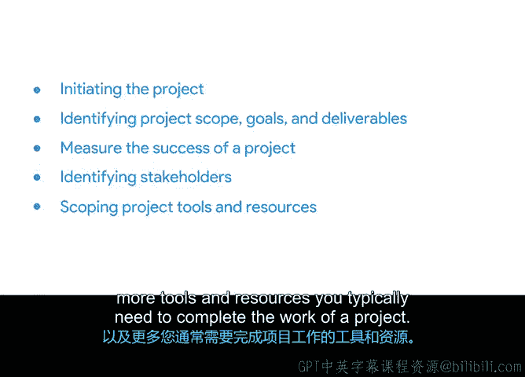

# 谷歌项目管理：专业证书 第2课：《项目启动：成功启动项目》｜project-initiation-google｜ - P1：01_01_01_课程介绍-2.zh_en - GPT中英字幕课程资源 - BV14h4y1D7Hr

Hi there， welcome This course is all about initiating a project successfully。

If you haven't gone through our foundational course yet， we recommend checking it out。

🎼It covers the foundations of project management and contains lots of helpful information for anyone wanting to start a career in this field。

 There are lots of people around the world like you who are hoping to learn the skills to get a project management role。

Maybe you prefer to take a specialized certification rather than a four year degree。

Maybe you're looking for an affordable way to stand out among competition。

Maybe you're interested in changing your career。Whatever your reason for being here。

 we are glad you've joined us。This program is rooted in the belief that a strong foundation in project management can help anyone start a great career as a project manager。

Before we begin this course， let me introduce myself。My name is Joanne。

 and I'll be your instructor for this course。As a senior program manager at Google for the past eight years。

 I have worked on cross functional projects involving product managers， software engineers。

 user experienced designers， network operations， customer support and more to build software used at Google and used by Google Cloud customers。

I began my career working as a liaison between customers and engineers。

Documenting requirements on software development projects。As it became involved in larger projects。

 I started to manage the timelines of the projects and coordinate the work of the different teams that had to get involved to finish the project。

Before I knew it， I was the de facto project manager。

I have accumulated my knowledge through formal and informal training。

 finding practical application in finance， insurance and tech companies。

 I'm super excited to be sharing with you more about the project management discipline。😊。

During this course， you'll learn all the steps for kicking off a project。

We'll start with an overview of initiation， which is the phase that allows ideas to come together and form the beginnings of a plan for a project。

You'll identify the individual components of initiation like the project scope。

 goals and deliverables。You'll also learn how to measure the success of a project。

This is a super important piece of the puzzle。After all。

 you want to be able to meet or exceed all of the requirements for a successful project， right？Later。

 we'll talk about how to identify stakeholders。Stakeholders have a direct interest in the project's completion and success。

We'll teach you about some really helpful tools you can use to define project roles and responsibilities and more tools and resources you typically need to complete the work of a project。

Finally， we'll introduce documentation that can help your team prepare for Project kickoff exciting right？

The skills you learn in this course will help you start projects of your own。

We can't wait to get into these topics with you， so let's get started， Meet me in the next video。

