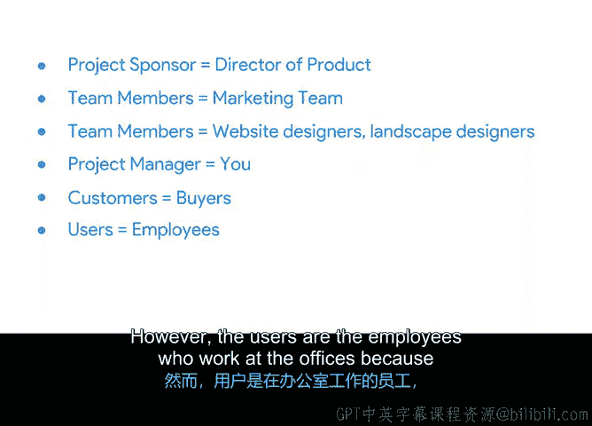

# 谷歌项目管理：专业证书 第2课：《项目启动：成功启动项目》｜project-initiation-google｜ - P20：20_03_05_定义项目角色.zh_en - GPT中英字幕课程资源 - BV14h4y1D7Hr

As we mentioned in the last video， when you are managing a project to meet certain goals。

 having the right team around you is a must。Why is it so important。

 It's because there can be so many moving parts on a project。

That means you really need to have confidence and trust that the people around you have the skills and motivation to do the work well。

To feel confident in your team， you need to know each person's role from the start。Clearly。

 laying out the responsibilities for each role helps everyone know what project tasks they are accountable for。

Ods are， you can't complete this project on your own。

 even if you're the best project manager of all time， which we know you will be。

Before we jump into the specific rules on a project。

 we want to call out that some rules aren't fixed。Sometimes team members need to adapt and take on more than one role at a time。

This usually happens if the company is small or resources are limited。For example， at a small firm。

 you might be the project manager， designer and marketer。Whether they're fixed or not。

 we always have these project rules。Project sponsors。Team members。Customers or users。Stickholders。

 and， of course， the project manager。Let's learn more about each of them。

A project sponsor is the person who is accountable for the project and who ensures the project delivers the agreed upon value to the business。

 They play a vital leadership role throughout the process。Sometimes they fund the project。

The sponsor will probably communicate directly with managers and key stakeholders。

 Team members are the heart of the operation。 They're the people doing the day to day work and making the project happen。

The customers are the people who will get some sort of value from a successfully landed project。

 since the project aims to deliver something useful to the customers。

 the customers' needs usually define the project's requirements。

You can think of them as the buyers of the project。In some situations。

 we have both customers and users for a project， and we need to differentiate between the two。

Simply put users of the people that ultimately use the product that your project will produce。

To make the distinction nice and clear for you， think of it this way。

A software company has created a type of software that allows teams to communicate with each other in an instant message application。

The software is purchased by Corporation， ABC。They are the customer。

But the users are everyone one within corporation ABC that will be using the instant message application every day。

Stakeholders are anyone involved in the project。Those who have a vested interest in the project's success。

 primary stakeholders are people who expect to benefit directly from the project's completion。

While secondary stakeholders play an intermediary role and are indirectly impacted by the project。

Secondary stakeholders may be contractors or members of the partner organization。

The both primary and secondary stakeholders help project managers define project goals and outcomes。

 And finally， we can't forget the project manager， the person who plans。

 organizes and oversees the whole project。 That's you。

Let's now plug these rules into our office screen project。

Recall that office Green is a commercial plant company that does interior landscaping and plant design for offices and other commercial businesses。

We're launching our new plant service。 So if you recall our smart goal， which must be specific。

 measurable， attainable， relevant and time bound。Is to roll out a new service to provide office plans to top clients by the end of the year。

There's a lot to do when launching a new service。Plants need to be ordered and delivered every few days。

New clients will need to be familiarized with office screen and its procedures。

And there will be ongoing updates to the website and app for office Greens launch。

 Our project sponsor is the director of product。They approve the project's budget and ensure that everything stays aligned to the vision。

Which in this case， is that inexpensive and easy to maintain live plants are provided in order to improve the employee work environments。

The teams made up of people from across departments。

 and they're all working together to support the project。For example。

 the marketing department has assigned some people to the team because they'll need to tell customers about this new service。

On this project， the landscape designer is also the website designer。

This is an example of where a team member plays more than one role。And you。Dre the project manager。

You're the one managing the information， people and schedule to carry this project to a successful landing。

 Our customers for this project are buyers at offices who might be interested in office screen services。

Such as the office managers or procurement teams。However。

 the users are the employees who work at the offices because they're the ones who enjoy the plants。

And finally。All of these people are project stakeholders。

Secondary stakeholders won't play active roles throughout all phases of the project。

But still need to be informed as they are a component of what the project needs to succeed。

 For example， these include office screens， investors who are helping to fund the new service launch and the office screen receptionist who will answer a lot of customer questions about the new service once it's launched。

So now that we know why it's so important to decide on these roles early on and how these roles work within a project。

 let's put them into action。