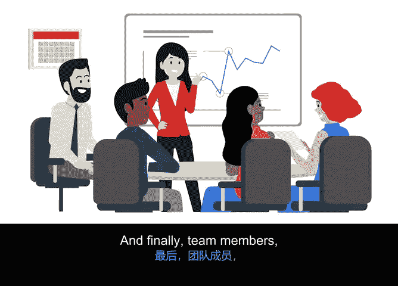

# 谷歌项目管理：专业证书 第2课：《项目启动：成功启动项目》｜project-initiation-google｜ - P23：23_03_01_RACI责任矩阵要素.zh_en - GPT中英字幕课程资源 - BV14h4y1D7Hr

In the last video， we saw how a stakeholder analysis shows us how to best work with stakeholders and when to communicate with all the different people involved in the project。

In this video， we're going to check out another handy tool called a Racy chart。

A racy chart helps to define roles and responsibilities for individuals or teams to ensure work gets done efficiently。

It creates clear roles and gives direction for each team member。

 There are four types of participation included in a Ra C chart。These are responsible， accountable。

 consulted and informed。Let's take a look at each。Responsible refers to those doing the work to complete the task。

Accountable refers to those making assure at the work gets done。

Consult it includes those giving feedback， like subject matter experts or decision makers。And lastly。

 we have informed， which includes those just needing to know the final decisions or that a task is complete。

Here's an image of how this breaks down in a chart form。When creating your Racy chart。

 you will need to write down each task or deliverable for your project and then assign it the appropriate role for each stakeholder。

To do this。First， think about who's involved in the project。

Write the roles or people's name in a row across the top of your chart。Prot tip。

Use roles rather than names。 If some people might take on more than one role。Next。

 write down the tasks or deliverables in a column on the left。Try not to get too specific here。

 You want the chart to be simple and easy to read。After that。

Go through each ta and deliverable and ask who's responsible for doing this。

Who's accountable if it doesn't get done。Who will have strong opinions to add and therefore should be consulted about how this gets done。

And who needs to be informed of the progress or decisions made about this。Assign the letters R， A， C。

 and I， based on your answers。For example， as a project manager on office screen's new service launch。

 one of your tasks is to create different price points for different packages and delivery frequencies。

The head of finance will be accountable because the project needs to stay in budget and make money。

But it's the financial analyst who's responsible。As there the person doing the work in determining optimal pricing。

The director of product will be consulted on the matter。As they oversee the product offerings。

And finally， team members， like those on the sales team， need to be informed of the final pricing。

It's possible there are several rules that fall into the informed and consulted categories。

One thing that will always remain constant。Is there will never be more than one person designated as accountable。

This prevents confusion because having one person accountable clearly defines ownership。However。

 the same person that is accountable may also be responsible。

 There are several other factors that can cause roll confusion。For example。

There might be unbalanced workloads， which means some people might be doing more work。

Or less work than others on the team。Or there could be an unclear hierarchy when people aren't sure who to seek help from if a task doesn't get done。

Or unclear ownership of decisions。Or people aren't sure who makes the final call on a project。

Another issue could be overlapping work。This is when teams or individuals feel that they're responsible for the same work。

When this happens， things can get confusing fast。And the same goes for excessive communication。

While communication is usually a good thing。Too much communication can actually make things more complicated。

It can cause information overload where people don't know what to pay attention to。

 And so they miss something important。Wow， there's a lot of things that might cause confusion。

But all these issues can be resolved or even prevented with a ra analysis。

Be proactive and do this work up front， and you'll help ensure the success of your project。

