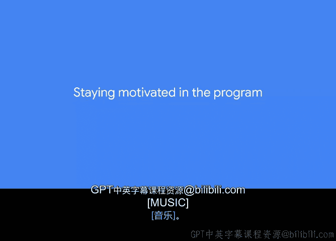

# 谷歌项目管理：专业证书 第2课：《项目启动：成功启动项目》｜project-initiation-google｜ - P24：24_03_03_证书获得者-保持学习动力.zh_en - GPT中英字幕课程资源 - BV14h4y1D7Hr

If something is stumping you or you feel stuck at a certain aspect。

 there's always someone else who's going through the same thing。

Anytime I started to feel overwhelmed by information or like I just wasn't getting it。

 I wasted so much time being unsure of myself that I should have just listened to my friends and family when they said just do it。

 you can do it One of the greatest thing that helped me to get back motivatedtivating is the accessibility of the course on my phone I would just able to go into the app and listen to a videos because I can learn it on the go Having a network of people that motivate to it's so fundamental you know。

 even if it's a friend or if it's a family member that you can get from the beginning and he can be there for you on your co like a coach and don't be afraid to ask for help or be from your peers from your coaches friends family。

 there's always someone who knows more and you can learn from them。

🎼。