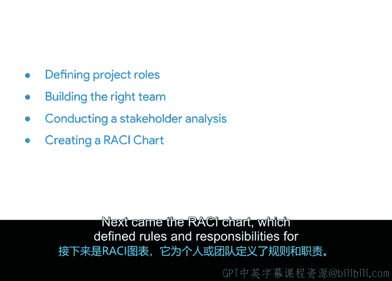

# 谷歌项目管理：专业证书 第2课：《项目启动：成功启动项目》｜project-initiation-google｜ - P25：25_03_02_总结回顾.zh_en - GPT中英字幕课程资源 - BV14h4y1D7Hr

Kudos， you finish another module。 That was a fun1。 We covered a lot of topics that were likely new to you。

 So let's recap In our first video， we checked out each individual rule associated with projects。

 You learn that as a project manager， you will have to ask yourself key questions to make sure you build a successful team。

😊，You have to consider things like team size， necessary skills， availability and motivation。

Then you completed a stakeholder analysis。This helps you understand how you might manage communication with each person on the project。

 Next came the Racy chart， which define rules and responsibilities for individuals or teams。

 This helps people get work done efficiently， and it creates clear lanes and instruction for each team member to operate within。

It does this by assigning which roles are responsible， accountable， informed and consulted。 Overall。

 you learn some really useful concrete tools to help you stay organized throughout the project。

You can use these charts as you work with your stakeholders。And if your project is ever evolving。

 as some are， stakeholder mapping and Racy charting will help you stay on top of the tasks and communicate effectively In the next module。

 you learn about other useful resources for managing projects and discover how to know which tool to use when。

See you soon。