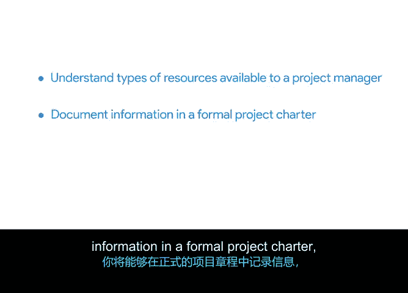

# 谷歌项目管理：专业证书 第2课：《项目启动：成功启动项目》｜project-initiation-google｜ - P26：26_04_01_引言-运用资源和工具实现项目成功.zh_en - GPT中英字幕课程资源 - BV14h4y1D7Hr

Welcome back and congrats on completing that graded assessment in the previous module。

 you learn all about project roles and responsibilities。

 and we introduce you to some tools that you can use to ensure team accountability like stakeholder analysis and racecy charts Com up。

 we'll talk about project tools and resources and the value of documentation by the end of this module you'll understand the types of resources available to a project manager you'll be able to document information in a formal project charter and you'll be able to compare and use various project management tools。

Ready to get started？Meet me in the next video。