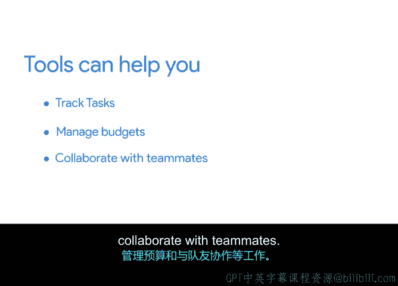

# 谷歌项目管理：专业证书 第2课：《项目启动：成功启动项目》｜project-initiation-google｜ - P27：27_04_02_关键项目资源.zh_en - GPT中英字幕课程资源 - BV14h4y1D7Hr

So far， you've learned how to determine project goals and scope and how to identify the right stakeholders for a project。

Now， it's time to add another important ingredient resources As a project manager。

 understanding your resource needs is crucial to achieving your goals。So during the initiation phase。

 it's important to ask yourself。What are the things we still need to acquire in order to complete our project。

 Project resources usually include budget。People and materials。

 you'll use tools to manage all those resources as you think about the goals and the scope of the project。

 you figure out the different resources you'll need to meet those goals。

 It's important to figure out your resources before the project gets rolling。

This makes it easy for everyone on your team to get their work done。

And that's your job as a project manager。 You won't be doing the work directly。

 but you'll support the people who do。Figuring out resources early on also helps you avoid accidentally understaffing your project。

Which can seriously slow down team progress and eat away at the overall timeline。 even worse。

 if you're not careful with your resource planning。You could wind up underestimating the budget。

 meaning you might not have enough money to purchase necessary materials。

 hire vendors or support overtime requests。 Plan your resources early is a great way to set your team up for success。

 because when your teammates have what they need to do their work on time and on budget。

 They're better set up to meet the project goals。 Now。

 let's break down some of the resources that project managers typically work with。 First。

 let's talk about budgets。 A budget is an estimate of the amount of money a project will cost to complete Almost all projects have budgets because they need funding for expenses like buying the right materials or software。

 hiring vendors to complete jobs or doing marketing once the project's done。

 During the initiation phase。 You'll talk to the stakeholders and the people working on the project to figure out the tasks needed to get the project done here。

 you might ask questions to help uncover hidden costs。For example。

 are there any taxes on products that you need to account for。What about extra fees。

 All this information will help you create a budget which you can use to source and compare proposals from vendors。

Figure out upcoming costs and track all the money moving in and out of your project。

 You often include the budget and the project charter， and the stakeholders review it for approval。

We'll talk more about what goes into creating a project budget and creating a project charter later on。

When we talk about resources， we're also talking about the team of people who help execute the tasks of a project。

 For example， you， as the project manager， are a resource。

So is the marketing manager who might create advertisements for this new product。

Other resources can include people outside of your company who have unique skills and can do certain tasks that people in your organization can't do personally。

Then you have materials。These are items you need to help get the project done。 For example。

 project materials might include the lumber needed to complete a construction project。Okay。

 so you know that project resources include budget， people and materials。

How do you organize these resources， That's actually a nice transition into our next topic。

 which is tools。 To are As that make it easier for a project manager or team to manage resources and organize work。

 They help you do things like track tasks， manage budgets and collaborate with teammates。😊。

There are all kinds of tools out there， including productivity tools like Google Docs and work management software like Asana。

 We'll talk more about these tools later in this program。 Tos are essential for tracking progress。

 So you want to keep them top of mind at all phases of your project。😊。

Let's talk about how you might determine your resources during the initiation phase of your project at office screen。

 As a reminder， the plant P service offers customers small。

 low maintenance plants like cacti and leafy ferns that they can place on their desks。

 Custom can order them online or from a print catalog。

 and office screen will ship the plant straight to the customers's work address。

The project goal is to increase revenue by 5 per cent。 So how do you get started。Well。

 you might do some research to figure out the costs of launching the new plant service。

That might include the estimated prices of developing a new website and new promotional materials。

 as well as shipping and delivery costs。 You also might want to budget for specific tools like a project management software that will help you track progress on this complex project With that information。

 you can start to build a realistic budget。And you'll also need to figure out who's working on this project with you to do this。

 you might make a list of people and external vendors who will help complete all the projects's tasks。

 For example， the person who manages client communications with customers or a new plant supplier that can provide you with your product。

 Great， Hopefully you are getting more comfortable with the types of resources you'll need not only to get stuff done but to achieve your project goals。

 too， in the next video will talk about documentation。

 another important topic for anyone who manages projects professionally。😊。

