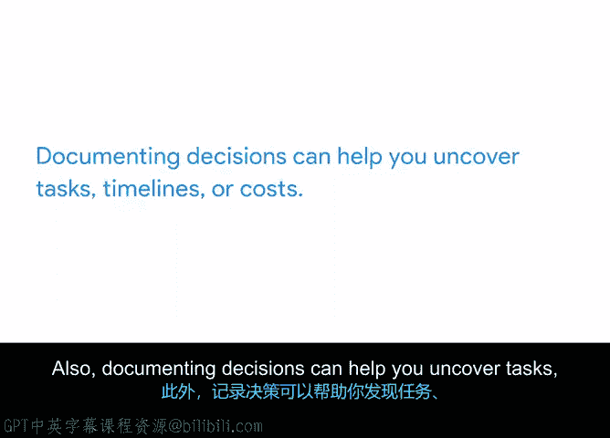

# 谷歌项目管理：专业证书 第2课：《项目启动：成功启动项目》｜project-initiation-google｜ - P28：28_04_01_项目文档的价值.zh_en - GPT中英字幕课程资源 - BV14h4y1D7Hr

By now， you've probably noticed that a big part of project management is guiding decision making。

Even if you're not the one making final decisions on major aspects of the project。

 it's still your job to keep track of every new decision and use those decisions to create a plan。

 And as you've learned， there are a lot of important decisions to keep track of。

 That includes everything from identifying project goals and deliverables to choosing the right people to add to a team。

 It's way too much for any one person to mentally keep track of。

It's also important information for everyone on the team to be aware of， not just a project manager。

 If a decision affects a member of the team's tasks， they'll need to know about it， right？

 That's why documentation is such an important part of a project manager's role。

 While your team may work deeply on specific areas of the project。

You might be the only person on the team who is aware of and communicating across all the different areas of the project。

 Clearer and consistent documentation can ensure transparency and clear communication。

 documentationcumentation helps set the stage for the project。

It communicates the answers to key questions。 For example， what problem are you trying to solve。

 What are the project goals， What are the scope and deliverables and who are the project stakeholders。

And lastly， what resources does a team need to complete their work。

 This is all crucial information for anyone who's working on a project， regardless of their role。

 Documentation also helps preserve decisions made early on in the project and can serve as a reference point for team members who might join later in the project lifecycle。

 It's your job to ensure that this information is easily accessible through some kind of formal documentation like an email。

 a presentation or digital document。 Also， documenting decisions can help you uncover tasks。

 timelines or costs you hadn't previously considered。

And lastly， this process provides a historical record that can be reviewed at the end of your project。

You can apply the lessons you've learned in the future。 Okay。

 let's get into different types of documentation。Up next。

 we'll look at project proposals and project charters。

 two types of documents that can set you up for success early on。See you soon。

