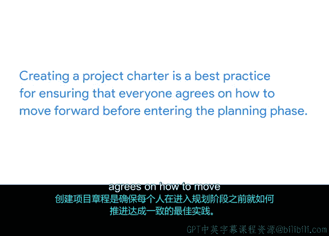
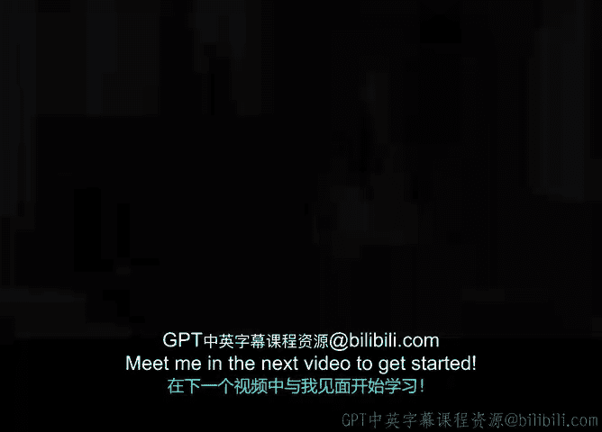

# 谷歌项目管理：专业证书 第2课：《项目启动：成功启动项目》｜project-initiation-google｜ - P29：29_04_02_项目提案与章程基础.zh_en - GPT中英字幕课程资源 - BV14h4y1D7Hr

Hello and welcome back。 Earlier， we discussed the value of documentation and effective project management。

 Now， let's talk about two common types of documentation you could use to keep track of details and keep your stakeholders informed。

These are the project proposal and the project charter。

 A project proposal is a form of documentation that comes at the very beginning of the project。

 This document's purpose is to persuade stakeholders that a project should begin。 and typically。

 a senior organizational leader creates the proposal。

 So you might not need to worry about creating the proposal。

 but you will have to keep track of the proposal's progress。

 The project proposal is a great starting point to help you understand the desired goals and impact。

 A proposal may be a formal document， a presentation。

 or even a simple email to get others on board with the idea。Then we have the project charter。

A far more document that clearly defines the project and outlines the necessary details to reach its goals。

A project charter helps you get organized， set up a framework for what needs to be done and communicate those details to others。

So how do these documents differ， A project proposal is created earlier in the project life cycle than the project charter。

 The proposal kicks off the initiation phase by influencing and persuading the company to move forward with the project。

 The project charter serves a similar purpose and often comes at the end of the initiation phase。

 However， its goal is to more clearly define the key details of the project。

 Another difference between these two documents is that a charter will often serve as a point of reference throughout the life of a project。

 The proposal is only used at the earliest stages。Now that。

 you know the difference between these two documents。

 let's take a closer look at the project charter， which you'll learn more about in this module。

 The project charter makes clear that the benefits of a project outweigh the costs。

 As you learned earlier in this course。 There are a few questions you might ask yourself when performing a cost benefit analysis。

 That includes questions like， what value will this project create。

How much money could this project save my organization。

And how much time will people have to spend on this project。

 You will include the answers to these questions in your charter。

 I this type of information ensures that you and your stakeholders agree on the project value。

 The charter also helps ensure that you and your stakeholders agree on the details of the project。

 Project charter approval means that management is supportive。

And it's also a key step to ensure that the project matches the needs of the organization。

After the stakeholders and project sponsor has reviewed and approved the project charter。

You now have the authority to move forward with the project。

 Project charters can be formatted in a few ways and can contain different information。

 depending on the project and the organization。The information in a charter might also be tailored to its audience or the needs of specific stakeholders。

 For example， if you are writing a project charter for a stakeholder who is a marketing executive。

The charter might include information about how the project will impact the organization's brand。

Or if the stakeholders is chief technology officer。

 the charter might include information on the costs of engineering resources needed to maintain the project。

Regardless of the format or the audience， C a project charter is a best practice for ensuring that everyone agrees on how to move forward before entering the planning phase。

The project charter is a living document。This means that it can evolve as the project progresses。

As the project manager， you will review and refine the charter throughout the process。

Now that you know more about the value of a project charter， it's time to learn how to create one。

Meet me in the next video to get started。

