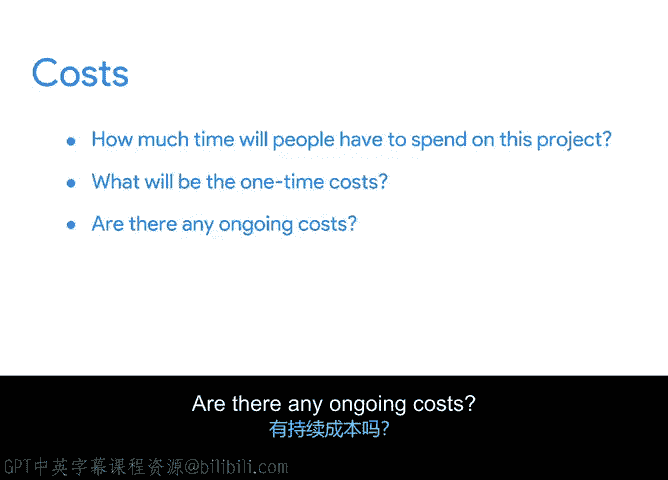

# 谷歌项目管理：专业证书 第2课：《项目启动：成功启动项目》｜project-initiation-google｜ - P2：02_01_01_项目启动为何至关重要.zh_en - GPT中英字幕课程资源 - BV14h4y1D7Hr

Welcome back in the last course， you learned that initiation is the first phase within the project life cyclee。

Followed by planning， executing and closing。Makes sense， right？Regardless of your chosen methodology。

 all projects have to start somewhere。Let's talk more about initiation and why it's important for the success of a project。

Because initiation is the first phase of the project， It's really important to get it right。

A well planned initiation results in a strong foundation for your project and sets it up for success。

Initiation begins after a problem or opportunity has been identified within an organization。Often。

 stakeholders like senior leaders at a company will initiate a project to address a specific need for the business。

For example， perhaps the company would like to roll out a new product。

Improve employee well being or reduce costs in the certain department。

It's your responsibility as the project manager to help identify the project goals。

 resources and other details based on initial discussions with the project stakeholders。

 even though some one else might come up with an idea for the project is still your job to figure out all the important pieces that need to come together in order to get the work done。

The initiation phase is a crucial time for asking stakeholders to write questions。

Performing research， determining resources， and clearly documenting the key components of a project。

Doing this will help you solidify the scope or the boundary of the project。

If this seems a bit overwhelming， don't worry， we'll talk more about Project scopepe later on in this course。

If a project isn't initiated properly， things can go wrong pretty fast。For example。

 without sufficient understanding of the project goals。

 you might underestimate what resources you need or how long the project may take。

Or without agreeing with stakeholders on what success looks like。

 you might think the project was completed successfully。

 while the stakeholders might think it didn't accomplish their goals。

 getting on the same page and gaining clarity during the initiation phase can save a lot of time and extra work for every throughout the project。

😊，Proper initiation also helps ensure that the benefits of the project outcomes will outweigh the costs of the project。

To determine this， you do what's called a cost benefit analysis。

Which is the process of adding up the expected value of a project， the benefits。

 and comparing them to the dollar cost。To do this， you would work with stakeholders to consider a few questions。

To determine the benefits of a project， those questions might include。

What value would this project create。How much money could this project save our organization？

How much money will it bring in from existing customers？How much time will be saved。

How will the user experience be improved。And to determine the costs of a project。

 those questions might include。How much time will people have to spend on this project。

What will be the one time cost。Are there any ongoing costs。

What about long term cost。The benefits of a project should always outweigh the costs。

 So it's really important that you consider these questions early on。Coming up。

 we'll talk more about the initiation phase and explore the key components of initiating a project。

Bye for now。