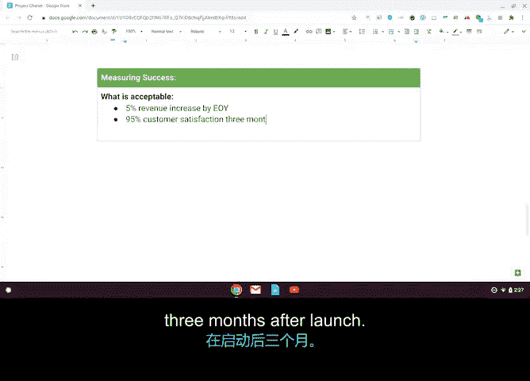

# 谷歌项目管理：专业证书 第2课：《项目启动：成功启动项目》｜project-initiation-google｜ - P30：30_04_04_制定项目章程.zh_en - GPT中英字幕课程资源 - BV14h4y1D7Hr

Hi again， let's talk about how to create a project charter。In the last video。

 we discussed how project charters are a valuable document for project managers。

Project charters are key for securing approval from stakeholders and moving forward。

 Project charters can also be formatted in many different ways。

 and there are many different templates available online for you to choose from。Here。

 we'll use a template that's similar to one that program managers often use at Google。

And to fill in each section will use details from your project at office screen。Ready。

Let's take a look。At the top of your charter， you want to add in the name of your project。

Let's add in the name of your project， at off the screen。It's called Project Plan P。

You also want to add in a brief summary。Let's type that in。

Our plan is to offer high volume customers， small， low maintenance plans that can thrive in an office environment。

Nextix up。 Let's fill in the section labeled project goals。 Remember that goals should be smart。

Let's add in the goal for project plant Ps， which is to increase revenue by 5% by rolling out a new service that provides office plants to top clients by the end of the year。

Great， now let's add in the project deliverable。Remember that a deliverable is a tangible outcome from a project。

As you learned earlier， our deliverables for this project are to send 1000 plants to 100 customers and to launch a new website for orders and customer support。

Okay， now let's add in the business case， which captures the reasoning for initiating this project。

Let's type in。 This is a top requested service from our customers。

 and it will also improve customer satisfaction and retention。

The business case is supported by the cost benefit analysis， and we'll add that in now。

Wills start with the benefits， The benefits or expected gains of the project include improving customer satisfaction and an increase in revenue。

Now we'll move on to the costs。 The costs include the price of the sourcing products。

 developing a website and marketing materials。Let's type in $250000 for the estimated budget。Nice。

 we've now outlined some of the benefits and costs of this project。

Keep in mind that these are simple examples to teach you the basics of filling out a charter。

When running a real project， you perform a more detailed analysis to determine the benefits and costs。

The key takeaway here is that benefits should always outweigh the cost。Fantastic， let's keep going。

 Next， we're going to add in the project scope， as well as what's considered out of scope for this project。

😊，Remember， scope is an agreed upon understanding of what is included or excluded from a project。

An item that is in scope includes creating a service to deliver small plants to last year's top clients。

An item that is out of scope and therefore not available to customers includes plant care after they're delivered。

Amazing， hopefully， you can see how stating what's in scope and what's out of scope helps everyone working on the project understand where they should focus their efforts。

😊，Great， now let's add in your project team。Let's see here。

 the project sponsor is Office Green's director of product。 So let's add that in。

Who is the project lead？ Well， that's you。The project team may include marketing associates。

 website developers and external plant vendors and more。

So we can add in a few important project team members here。Awesome。

 let's move on to additional stakeholders。😊，Additional stakeholders may include the vice president of customer Su。

 who is accountable for customer feedback and corresponding product requests。

We can also add in the account manager who will leverage their existing relationships with top clients。

Unless's also add in the fulfillment manager who will help acquire the plants needed to launch this service。

We're almost done。 let's add in how we'll measure success。Here。

 we'll type in that we want to see a 5% increase in revenue by the end of the year。

Let's also type in that we want to hit a customer satisfaction rate of 95% three months after launch。

That's it。 The project charter is filled in， and now it's ready to be reviewed by your stakeholders。

 Now you're done。You've seen how documentation helps form the roots of a project and how it contributes to the project's ultimate success。

Like nurturing a plan， you're learning to nurture a project to ensure it's the best it can be。 Up。

 Ns will talk about the tools that project managers rely on to guide their teams and ensure that they complete their tasks。

See you soon。