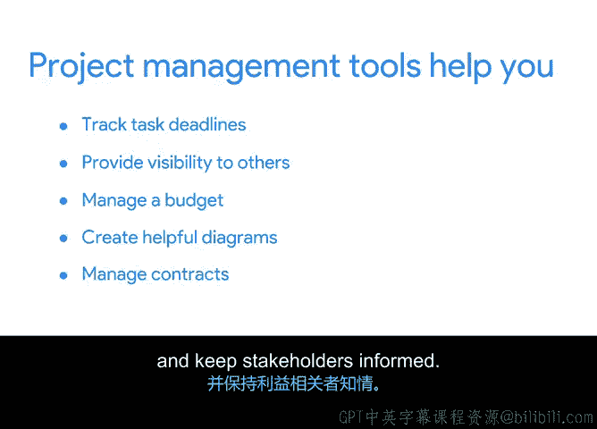

# 谷歌项目管理：专业证书 第2课：《项目启动：成功启动项目》｜project-initiation-google｜ - P31：31_04_01_运用工具实现高效项目管理.zh_en - GPT中英字幕课程资源 - BV14h4y1D7Hr

As a project manager， tools are some of the most helpful resources you have at your disposal。

They're essential for tracking progress。 So it's important to keep them top of mind throughout the entire project。

 Let's talk more about why tools are so useful and why it's important to choose the right ones for your needs。

There are lots of different tools out there， and you'll learn more about them later。As a reminder。

 tools are aids that make it easier for a project manager or team to manage resources and organize work。

They're useful because they can help you track detailed information about all kinds of tasks。

 and they make it easy to communicate with lots of different people。And remember。

 effective communication and tracking are huge parts of a project manager's day to day responsibilities。

Just think about how much tougher your job would be without help from collaboration tools like email or digital documents created in Google Docs or Microsoft Word。

Let's imagine this in the context of our project， at office screen。😊，As lead project manager。

 you have tons of information about the company's plan to provide office friendly plans to top clients。

But what would happen if you wrote every project detail on a whiteboard instead of a shared online document？

Well， a member of your team will have to stop by your desk to get the latest information。

And that's definitely not the most efficient use of anyone's time。

But if you store this information in easily accessible online documents。

 you save everyone on the team time， energy and a major headache。

 Today day's tools have made us so much easier to share information with teammates。😊，Even better。

 with project management tools， information sharing goes both ways。

That means team members can also easily update you on their progress without the need for extra meetings or phone calls。

How great is that。When you choose the write tool for a project。

 you make it easy for teammates to let you know if a task is on schedule or if it's delayed。

 which lets you quickly see how any changes might affect the rest of the project。

Project management tools increases visibility and transparency for everyone， including stakeholders。

You can use a variety of tools to accomplish many different things， like tracking progress on tasks。

 deliverables and milestones。😊，Tools can also help you manage a budget。

 build helpful charts and diagrams， manage contracts and licenses， and keep stakeholders informed。

Tools can be straightforward， like digital spreadsheets or documents。

 or they can be more sophisticated， like scheduling and work management software。

It's important to think about the needs of the project when choosing which to use。

One thing to keep in mind is that if you choose a more sophisticated tool。

Your teammates and stakeholders will need some time to get familiar with it。For small projects。

 that might be more trouble than it's worth。So for small projects。

 a straightforward tool might be more effective。But if a project has a big scope。

 then it might be worth the team's time to learn and ultimately work with a more sophisticated project management tool。

You should also keep in mind that sometimes you won't have the choice about the types of tools you use。

If an organization has already decided to use a specific tool。

Then you'll need to work with what they give you。It's all about remaining flexible。

Are you starting to see how you can use tools to keep projects on track。

Whether they're straightforward or sophisticated tools have the power to help you communicate and manage more effectively。

Next up， we'll cover some of the most common types of tools for effective project management。

See you there。