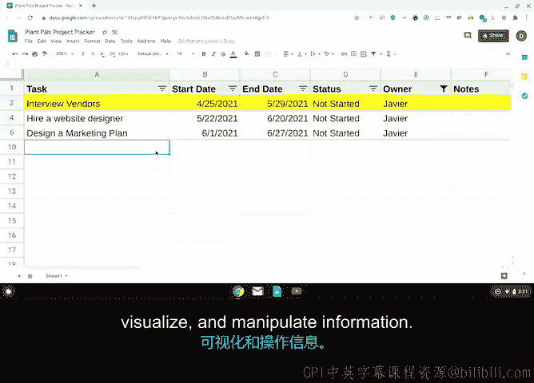

# 谷歌项目管理：专业证书 第2课：《项目启动：成功启动项目》｜project-initiation-google｜ - P33：33_04_04_常用项目管理工具.zh_en - GPT中英字幕课程资源 - BV14h4y1D7Hr

Earlier， you learned about different types of project management tools from scheduling and work management software to tools for productivity and collaboration。

Now， let's discuss a few popular tools you might be expected to use or at least be familiar with。

There are many different types of work management software that automatically make project planning and tracking a lot easier and that are much more efficient than manual project tracking。

One tool that we'll focus on in this program is Asana。

Asana is a work management platform that helps teams plan and coordinate their work from daily tasks to strategic initiatives。

Asana provides a living system and a source of truth where everyone's work lives with Asana。

 everyone can see， discuss and manage team priorities。

 giving teams clarity on who is doing what by when。It's great for building project plans。

 assigning tasks。Automating workflows， tracking progress and communicating with stakeholders。

As a project manager， you can use Asana to create a log of tasks like gathering cost estimates from external vendors and assign a task to people on the team。

All tasks are visible and organized in the format of the project manager's choice。

Like an ali or on a calendar。And designed to drive transparency and connection with all the tasks related to the overall goal。

It's easy to use with external stakeholders as well， because within Asana。

 you can share status updates and other communications with people outside your company。

Another great tool we'll focus on throughout this program， is the spreadsheet。

Spreadsheets are extremely versatile， and you can use them for a wide range of tasks from creating timelines and building charts to managing budgets and tracking tasks。

You can add and view project information in a variety of formats depending on what you need in the moment。

For example， let's say you enter a list of tasks， due dates， completion statuses。

 and task owners into a spreadsheet。From there， it's very simple to sort the list by due date to see what's due next。

You can then filter the list of tasks by task owner so that you'll only see the things you're responsible for。

You can also highlight the rows of the sheet in different colors to visually illustrate the tasks with the least progress。

With spreadsheets， you can easily transform， visualize， and manipulate information。

Spreadsheets and more comprehensive tools like Asana are just two options for effective project management。

And it's a good idea to get a basic understanding of a variety of software options out there。

Then if your company doesn't have a standard software tool。

 you can choose to write one for the project needs。

Being able to recommend the right tool for the job can be a great way to add value to your team at the beginning of a project。

Keep in mind， however， that software options are constantly changing。

From the addition of new features to the launch of new tools。

There's no way for you to know every software available， and no company would expect that of you。

Many of these tools have similar functionality like task tracking and task assignment。

So if you understand one tool deeply， you should be able to easily adapt to a new tool on the job。

Now that you've learned a bit more about Asana and the power of spreadsheets。

 take some time to explore these tools since we'll be working with them later in the program。

Coming up， you hear from a project manager who will tell you all about their experience using tools during their day to day role at Google。

 Stay tuned。😊。