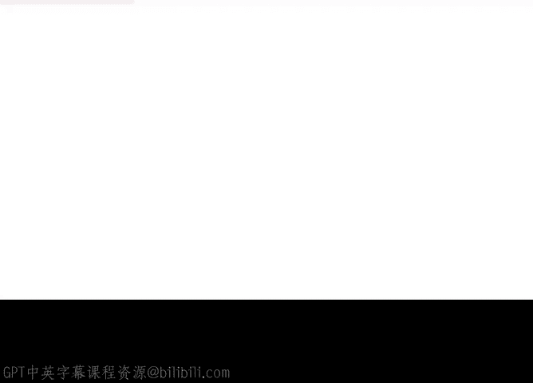
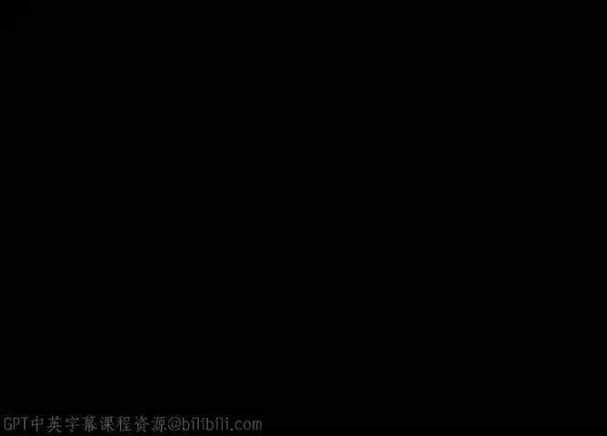

# 谷歌项目管理：专业证书 第2课：《项目启动：成功启动项目》｜project-initiation-google｜ - P34：34_04_08_阿马尔-工具是我们的最佳伙伴.zh_en - GPT中英字幕课程资源 - BV14h4y1D7Hr

Hi， I'm Ammer， I'm a senior engineering program manager at Google Shop。

 and on a day to day basis I drive programs which spans across multiple products at Google as a project manager Tool are our best friends。

Tools and the tools which should help us drive the execution。

 Those are really should be near and dear to us。 And those are near and dear to me。

 What I look at is what tools which help me create the body of work。

 There are like lot of open source tool， as well as free tools like you know Google spreadsheets are there。

 Google Docs is there。 So many of these tools are out there。

 And there are some others supporting tools also like Gra and all。😊。

These will help you create the body of work。 This will help you define that what needs to be delivered and when this will help you create the timeline like there are timeline tools like Gantchar Gant tools that you will find out and then there are tools which will help you drive the visibility across the board and drive the dependent ecosystem。

 we want to make sure when we are starting at the project。

 we look at the available tools set so that we are not defragging the system that much we are not really kind of。

Adding。Too many complexities or new tools in the ecosystems， we want to make sure that okay。

 what are the current tools which are out there have a look at those tools set。

Find out are those supported。 Find out what's the current adoption rate and look at what are the gaps if there are gaps go for new tools。

 propose new tools。To improve productivity， but if there is existing tool set which our team is following。

 which your team is following。Try to learn those tools because those are the tools which will get quick adoption and those will be an amazing tool set to have with you。

