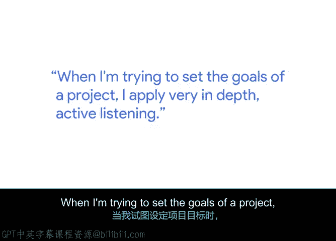
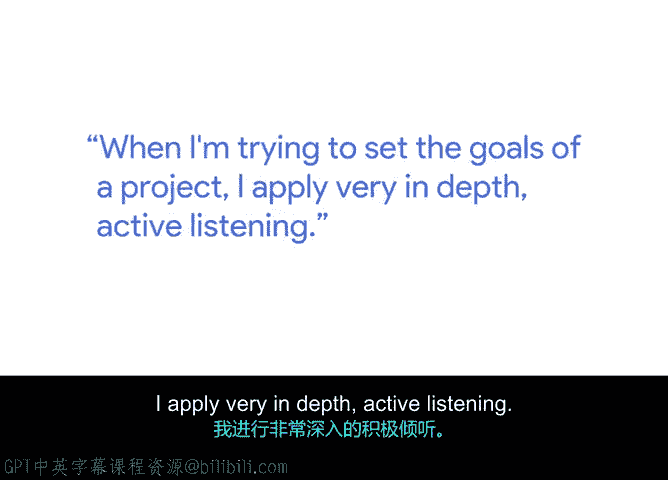
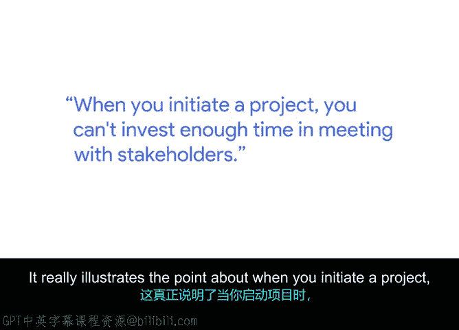
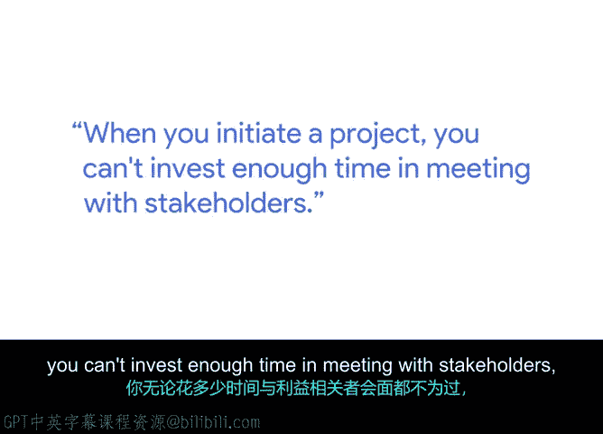

# 谷歌项目管理：专业证书 第2课：《项目启动：成功启动项目》｜project-initiation-google｜ - P4：04_01_03_阿夫辛-倾听学习.zh_en - GPT中英字幕课程资源 - BV14h4y1D7Hr

Hi， my name is Afshen， I'm the director of core capacityacity at Google。

 where we support some of our key products such as Google Maps， Google Photos。

 Google search and many more Ultimately what we're doing is we're managing the supply and demand for our products in the resource space so specifically compute。

Storage， machine learning and networking resources。Ultimately。

 our goal is to provide the fuel for these products so we can support our billions of users。

 I often look at establishing the project goals and tied to the goals is discussing the criteria。

 What's the successful project， whether the measurables involved in the project space。

And then lastly， I always want to look at the stakeholders that are involved， maybe our clients。

 our key stakeholders and so on。 and make sure that they're thought of during the formation of the project。

 I'm meeting with the stakeholders。 I'm trying to understand what they're trying to achieve what we're trying to achieve and the goal。

 if you will， is a critical aspect of setting the scope。

 when I'm trying to set the goals of a project， I apply very in depth active listening。

I'm doing a lot of。Socializing with stakeholders。 I'm meeting a lot of players to understand what's the landscape like。

 I I really， it's an active listening experience。 So I have a recent example of a project。That。

 in my view， did not do the proper initiation phase。Last week， in fact， a group approached me with a。

Process or a feature that they were going to launch。I reviewed it。

And immediately realized that they were。 They were so far off。

They had not discussed the topic with any of my team members or myself， and they were。

Day -1 from launching the feature as a total miss。 And it really illustrates the point about when you initiate a project。

 you can't invest enough time in meeting with stakeholders， meeting with your， your colleagues。

You know， listening to them， actively listening， Someone taught me recently the value of。

 of building that listening to learn muscle。And in the project initiation phase， to me。

 that is such a valuable talent， there are those that have it。

 there are those that haven't learned it， and there are those thatll never do it。

And I believe it's a trainable skill。But it requires you to really slow down and look at the landscape in front of you。

