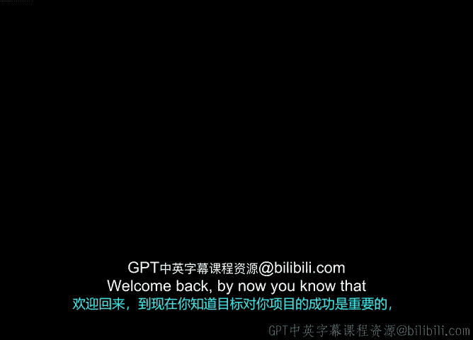
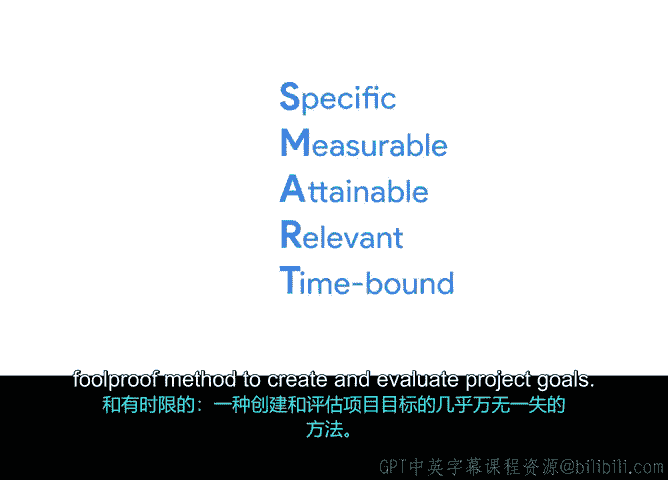

# 谷歌项目管理：专业证书 第2课：《项目启动：成功启动项目》｜project-initiation-google｜ - P8：08_02_03_如何设定SMART目标.zh_en - GPT中英字幕课程资源 - BV14h4y1D7Hr

Welcome back。 By now， you know that goals are important to the success of your project。And。

 you know that they need to be well defined in order to help keep your project on track。

 Since your deliverables depend on your goals， it's in your best interest to get those goals as well defined as possible。

Lucky for you。 I've got an easy method for doing just that， setting smart goals。

I already mentioned that goals should be specific and measurable。

The smart method to evaluate goals add three more considerations for success。Be attainable。

 be relevant， and be time bound。Put them all together。 And what do you have， Smart goals。

As an entry level project manager， you may or may not be setting the project's main goals。

 but you will need to be able to identify and clarify them as needed。

And that's where the smart method can be a valuable tool。Let's take a closer look at each term。

As I've already mentioned， if your goal is not specific。

 you'll have trouble figuring out how long it should take to complete and whether or not you've accomplished it。

For example， if the goal was simply to improve customer service response time。

 that's now very specific。It does tell you what you want to achieve in general。

 but it doesn't say anything else。If you improve response time by 1 per cent， is that enough。

If after five years， response time finally goes up， Is that enough。

How about if only half of your staff improves their response times。

 but the other half stays the same。Specific goals should answer at least two of the questions I'm about to ask。

What do I want to accomplish。Why is this a goal？Does it have a specific reason， purpose or benefit。

Who is involved and who is the recipient， employees， customers。The community at large。

Where should the goal be delivered。And finally， to what degree。😊，In other words。

 what are the requirements and constraints， Next， we want to set goals that are measurable。

 meaning we can determine that they were objectively met。

Measuring is not only a way for people to track progress。

 but also a tool to help people stay motivated。You can tell a goal is measurable by asking how much。

 how many and how will I know when it's accomplished。

Sometimes the success of a goal can be measured with a simple yes or no。

Did you learn to play the guitar， Yes or no。You will need to measure most of the goals you have with metrics。

Metrics are what you use to measure something like numbers or figures。For example。

 if your goal was to run a 5 k， a 5 km race。The distance in kilometers is  geoumetric。

At office screen， the project goal is to increase revenue by 5%。In this case， revenue is the metric。

 Lastly， consider benchmarks or points of reference to make sure you choosing accurate metrics。

 for instance。If your overall goal is to increase revenue。

 you can look at last year's data as a benchmark for deciding how much to increase revenue this year。

If last year's revenue increased by 3%。Thenhan an increase by 5 per cent in a booming economy would be a reasonable goal for this year。

 Okay， so the goal is specific and measurable。But is it attainable？

Can it reasonably be reached based on the metrics。Typically。

 you want goals that are a little challenging to encourage growth。Otherwise。

 what's the point of the goal of nothing's going to change。 However。

 you don't want it to be too extreme， or you'll never reach it。

 You'll have failed before you even started。Aim to find a balance between the two extremes。

 For example， let's take the goal to run a 5 k。 Sa you regularly run 2。5 km， three times a week。

 An attainable goal will be to go from running 2。5 k to running 5 km within four weeks。

An unattainable goal might be earning first place in the 5 K。 I mean， it could have。

 but it's not likely， especially if you've never run a race before。

 But how can you know if a goal is attainable if it's unfamiliar。

A clue to helping you figure out if your goal is attainable is to ask， how can it be accomplished。

Break down the goal into smaller parts and see if it makes sense。Going from 2。

5 km to 5 km over four weeks means increasing your distance by a little over half a kilometer each week。

That's not so bad。Use the same process on your office screen project goal。

Businesses usually conduct quarterly reviews。 So let's assume the increase is expected to occur over the course of a year or four/ quarters in order to meet the goal。

 you need to see an increase of at least 1。25 per cent each quarter。Seems pretty reasonable to me。

What wouldn't be reasonable is setting a goal of increasing revenues by 50 per cent or 100 per cent。

 unless your research showed that business was improving that quickly。Your goal is specific。

 measurable and attainable。Now， let's see if it's relevant。In other words。

 does it make sense to try and reach the school。Think about how the goal lines up with other goals。

 priorities and values。Ask whether the goal seems worthwhile。

Does the effort involve balance out the benefits。Does it match your organization's other needs and priorities。

 Everyone from the client， the project team and the people who will ultimately use the productda need to feel like the goal is worth supporting。

And also consider the timing。Both the amount of time the project will take。

As well as the larger economic and social contexts can have big impacts。

There might be a budget to complete the project now。

 but will the company be able to sustain the project over time。

Is there an audience that will continue to use the product or service once it's delivered。

Once you've got the answers to these questions， you should have a clear goal to help steer the project。

If you still don't feel confident about the project's goals， keep digging。It's okay to ask questions。

 if you have doubts。Communicate your concerns with the project senior stakeholders and your direct supervisor。

 if you have one。They should be able to address some of your concerns so that you can feel confident about moving forward。

 All right， if you're feeling good about the project being relevant and attainable and you've made sure it's measurable and has the specifics to keep you and your team focus。

😊，The final item on the checklist is to make sure it's time bound。

Time bound means your goal has a deadline。Deadlines give you a way to track your progress。Otherwise。

 you may never reach your goal or never even get started。

Time and metrics often go hand in hand because time can also be used as a metric。

 Miking your gold time bound gives you a way to break down how much needs to be accomplished over time。

For example。If you need to increase revenues by the end of the year。

 you can break down how much you need to increase each quarter， Mon and week。

 And there you have it specific， measurable， attainable， relevant and time bound。

A nearly foolproof method to create and evaluate project goals。

You know what they say， work smarter， not harder。 As we continue in this module。

 you learn about project scope and see how having clear goals supports all kinds of other decisions that come up during a project。

😊。