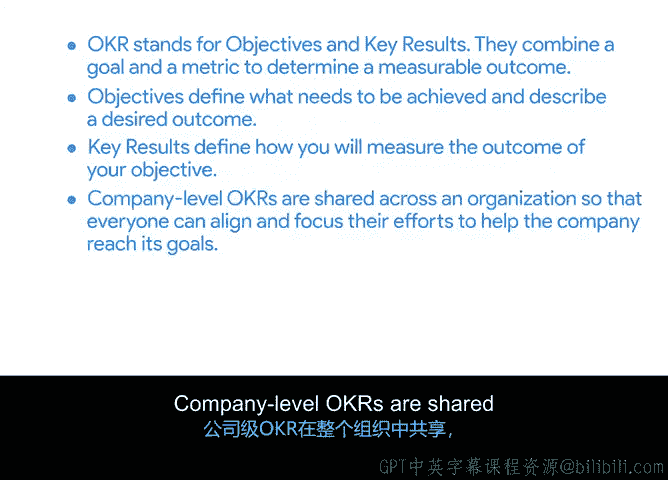

# 谷歌项目管理：专业证书 第2课：《项目启动：成功启动项目》｜project-initiation-google｜ - P9：09_02_05_OKRs方法介绍.zh_en - GPT中英字幕课程资源 - BV14h4y1D7Hr

Hi there。 So far， you've been learning to define and create measurable project goals and deliverables。

😊，As you broaden in your understanding of project management and the different tools available to help you succeed。

 I want to teach you about a popular tool used in many organizations and here at Google。

Objectives and key results or O KRs。In this video， I'll discuss what O K Rs are。

How they are used by organizations。And how they help focus a team's time and effort on activities that drive success。

You've just learned about and practiced a smart method for defining project goals。

Like the smart method， O KRs help establish and clarify goals or objectives for an organization。

Department， project or person。O K Rs takes smart goals a step further by combining a goal and more detailed metrics to determine a measurable outcome。

They not only state clearly what the goal is。They provide specific details that allow you to measure the success of the goal。

One way to think about O K Rrs is that they separate the different components of smart goal and clarify them even further。

 rather than grouping everything into one statement。Let's break this down。The O stands for objective。

And defines what needs to be achieved。It describes a desired result or outcome。

 such as an increase in customer retention or an improvement in the employee onboarding process。

KR stands for key results。These are the measurable outcomes that define when the objective has been met。

For example。If your objective is to improve customer retention。

Then a key result might be to have 90% customer satisfaction rating by the end of the first quarter。

Recall that one of the smart criteria is attainability。

Which means it's practical to achieve the goal。Key results， however。

 should be a little more ambitious。Here at Google， we actually use OKRs to set stretch goals as a way to challenge ourselves to do something we haven't accomplished before。

If we actually accomplish all of our key results， we may have made our OKs a bit too easy。

Let's review quickly。Objectives define what needs to be achieved and describe a desired outcome。

Key results define how you'll know whether or not you've met your objective。

So how do OKRs work in practice？And how do you use them to manage your project？

Organizations often set O KRs at different levels， such as the company level。

Department or team level。 and project level。Company level O KRs are commonly shared across an organization so that everyone is clear on the company's goals。

They are usually updated on an annual basis to help drive the organization in the direction it wants to go。

These high level O KRrs support the mission of the organization。

 Project level O KRrs should support and be aligned with company level O KRrs。

An example of a company level objective at office screen is increase customer retention by adapting to the changing workplace environment。

This is a big， big， aspirational goal that applies to the entire company and all of its endeavors。

In order to focus their efforts to reach this objective。

Office screening might develop key results that include 95% of phone。

 chat and email customer support tickets are resolved during the first contact。

Top three most requested new offerings for distributed office environments are in pilot by the end of the second quarter。

And sales and support channels are available 24，7 by the end of the year。

Some of these company level key results could become the basis for projects。For example。

 the key result， top three most requested new offerings for distributed office environments are in pilot by the end of the second quarter。

Could become the plant P project。Team or department level O K Rs support the company's broader O K Rs and help drive team performance。

Departments may develop OKRs that are more specific to their job function as well。For example。

 the company level key result sales and support channels are available 24，7 by the end of the year。

Could lead to a related sales department objective， like increase the sales team presence nationwide。

And the key result， new sales offices are open in 10 cities by the end of the year。

Project level O K Rs are set during the initiation phase to help define measurable project goals。

They track throughout the planning and execution stages to measure project success。

Project level O K Rrs need to align with and support both company and department level O K Rs。

For example。In order to align with office screen's company wide objective to increase customer retention by adapting to the changing workplace environment。

A project objective for plant pals might be to enroll existing customers in the plant pal service。

A key result for this objective might be 25 per of existing customers sign up for the plant P pilot。

Let's recap。O KR stands for objectivesjects and key results。

They combine a goal and a metric to determine a measurable outcome。

Objectives define what needs to be achieved and describe a desired outcome。

Key results define how you will measure the outcome of your objective。

Company level O KRs are shared across an organization so that everyone can align and focus their efforts to help the company reach its goals。

Project level O K Rs help define measurable project goals。

They need to align with and support both company and department level OKRs。Great。

 now that you have a better idea of what OKRs are and how they function。

 you can practice creating OKRs on your own。😊。