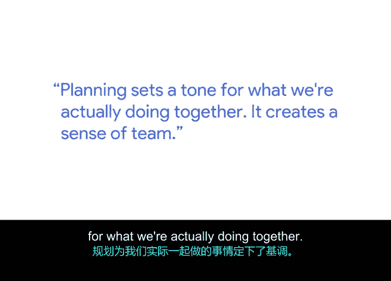

# 谷歌项目管理：专业证书 第3课：《项目规划：将一切整合起来》｜project-planning-google｜ - P10：10_01_02_克伦尼塔：规划如何营造团队归属感.zh_en - GPT中英字幕课程资源 - BV1Y94y1r7gw

Hi， my name is Cllinita and I'm a senior engineering program manager at Google So the planning phase of project management is essentially the time where you take step back and you reflect on what's the scope of the project so what are the problems that we need to solve When you look at planning for projects it's critical to understanding what you're building who you're building for and how long you have to build it we look at our risk to make sure that we know what potentially could derail the project and if possible create mitigation that will circumvent any risk that we may come in contact with or or just be aware of things like scope we also look at timing is there a time a deadline that we need to hit and if so do we have enough time to hit that deadline。

 we assess the work that needs to be done to understand if the work that needs to be done in order to meet the requirements fits into the timeline。

That we have we also look at testing what the testing plan looks like。

 what a success going to look like so we know what the target is so that when we hit the target and we validate it。

 we already know what metrics we expect to get I'm a planner like it's just in my nature planning that's a tone for what we're actually doing together it creates a sense of team。

The planning also aligns everybody to understanding what it is we're all shooting for。

 what it is our goals are what success is going to look like it really is the place where we come together to ensure that we're all on the same page and we're all going in the same direction when you don't have that things get lost you're not talking to the right people。

 you have miscommunications， things get delayed and you don't really understand why people aren't comfortable communicating。

 what you know what progress is happening， aren they really aren't comfortable in communicating when their problem comes up so you want to just set a tone of like we're all in this together。

 we're all going to be successful together and we are going to run into roadblocks we are going to run into problems but we're going to work it out and figure it out as a team。

