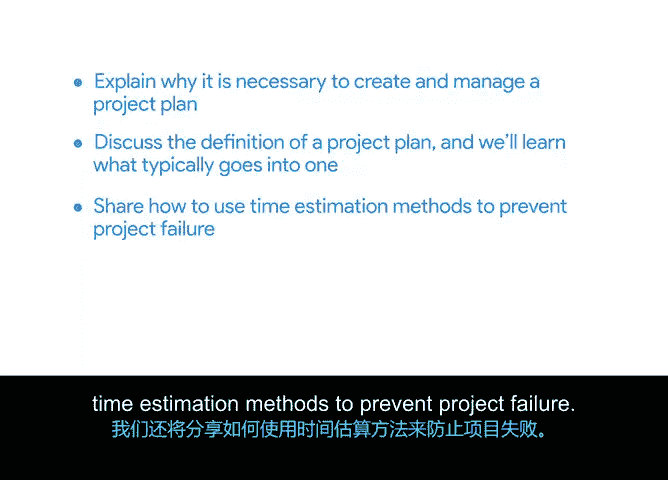

# 谷歌项目管理：专业证书 第3课：《项目规划：将一切整合起来》｜project-planning-google｜ - P11：11_02_01_引言：构建项目计划.zh_en - GPT中英字幕课程资源 - BV1Y94y1r7gw

🎼Hi， Wecom back In the previous section， we learned more about the planning phase。

 which is the second phase of the project lifecycl。🎼We introduced you to kickoff meetings。

 which is the first meeting for the project team。🎼We also discussed milestones。

 tasks and how to set these within a project。🎼Coming up。

 we'll explain why it is necessary to create and manage a project plan。

We'll discuss the definition of a project plan and we'll learn what typically goes into one。

This includes the project schedule， which will help guide your team to the finish line。

🎼We'll also share how to use time estimation methods to prevent project failure。

🎼We'll introduce you to a few time estimation techniques which can help you build an accurate project schedule。

🎼And finally， we'll examine tools and best practices you can use to build out a project plan。

🎼Ready to get started， meet me in the next video。