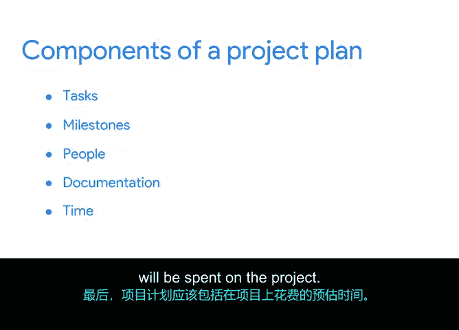

# 谷歌项目管理：专业证书 第3课：《项目规划：将一切整合起来》｜project-planning-google｜ - P12：12_02_02_项目计划的组成部分.zh_en - GPT中英字幕课程资源 - BV1Y94y1r7gw

A project plan can be useful for any project， big or small， since it helps you document the scope。

 tasks， milestones and overall activities of the project。

At the center of the project plan is the project schedule。

The project schedule can help you estimate the amount of time it will take to complete the project。

And it can provide the team with a way to track the project's progress against your goals。

 What goes into a project plan may vary from company to company。

 but most plans contain these five basic elements。 These are tasks， milestones， people。

Documentation and time。Let's break those down。A project plan will include tasks and milestones。

Two topics we discussed before。Tasks are activities that need to be accomplished within a set period of time。

They're assigned to different members of the team， according to their roles and skills。

And milestones are important points within the schedule that indicate progress。

 they usually signify the completion of a deliverable or phase of the project。😊。

A project plan will also include the people working on your team and their roles。

 It's important that each team member understands their role and the tasks they're responsible for completing。

Ensuring that everyone is clear on their assigned task frees you up to focus on managing the project。

And creates a sense of personal responsibility for members of the team。

A project plan is a good place to link to relevant documentation。

 This includes documents like your Racy chart， which helps to define roles and responsibilities for individuals on your team。

You can also link to your charter， which clearly defines the project and outlines the details needed to reach your goals。

Relevant documentation can also include documents like your budget and risk management plan。

 We'll discuss more about those later on in the course。Lastly。

 a project plan should include the estimated time that will be spent on the project。

 This forms the basis of the schedule， which is the anchor of your project plan。

The estimated time includes dates on which tasks should be started and completed。And the dates。

 when you hope to reach various milestones。It also includes the start and end dates of the project。

 which are important in determining which resources you'll need and when you'll need them。

So how exactly do you estimate how long these things will take？Meet me in the next video to find out。

