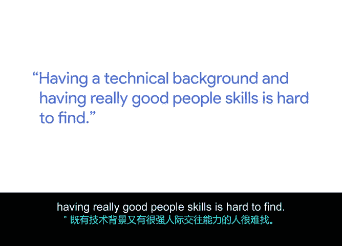
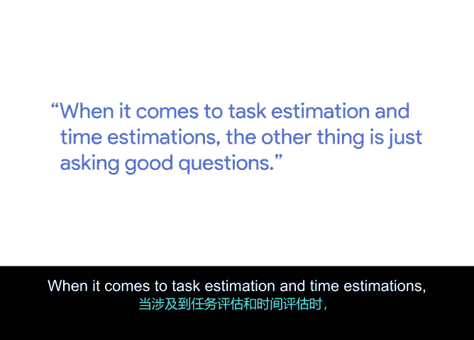

# 谷歌项目管理：专业证书 第3课：《项目规划：将一切整合起来》｜project-planning-google｜ - P16：16_02_07_安吉尔：人际沟通技巧在时间估算中的价值.zh_en - GPT中英字幕课程资源 - BV1Y94y1r7gw

Hi， my name is Angel and I'm a program manager at Google I'm a mechanical engineer by degree and。

I my first boss out of school said， you're an okay engineer。

 but your people skills are off the charts and having a technical background and having really good people skills is hard to find。

Soft skills to me have a lot to do with emotional intelligence so being able to read other people and then ultimately really knowing yourself and being able to read the team。

 read what they need， but then at the same time， you know what am I doing。

 you either influencing the team in a good way in a bad way， or just a different way。

 just asking sometimes people that don't usually kind of raise their hand to give input goes a long way because a lot of times the folks that are maybe a little more quiet are genuinely thinking about the problem and may have a lot of insights that if you didn't kind of catch on that or ask them。

 you could miss out and so to me soft skills just meetings just really understand kind of the emotional needs of the team and that can really help with you know whether it's estimations。

 or costs whether it be labor or dollar wise。Get kind of the full view from the team of what that might look like when it comes to task estimation and time estimations。

 the other thing is just asking good questions。 So not just， you know， I need you to go faster。

 but really saying， hey， how much faster could you go if I gave you this。

What is stopping you from going faster？You know what teams would you need to get involved to kind of help this right or hey we have an issue are there similar issues in other parts of this project and do we need to get together in a larger group to kind of bring that together I think as a program manager that's really your role is to kind of see patterns in a project and see kind of where things are either slowing down or at a complete stop and having those soft skills to be able to bring the team together to to solve that problem。

And to even just see it right just to acknowledge that there is a problem and instead of， you know。

 blaming is really just digging in and kind of how do we learn from this， how do we fix this。

 how do we move on， some of the things that also help is just relating to your team members。

And if you've either been in a similar situation or just trying to get understand what their process is。

 sometimes just having people walk through the estimate out loud can sometimes come up with realizations of oh。

 we could save more time or could improve this just by talking it out， I've been a project manager。

You know， for machines that make labels to locomotive engines to how you make plywood so project management skills。

 you know don't necessarily need to be。All about kind of the field that you're in。

 it's really more about kind of the method and the process and kind of how you structure a team and get people to work together。

