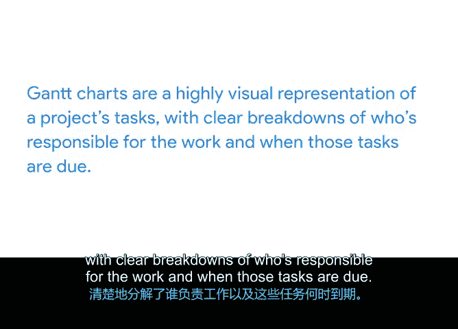

# 谷歌项目管理：专业证书 第3课：《项目规划：将一切整合起来》｜project-planning-google｜ - P17：17_02_01_制定项目进度表.zh_en - GPT中英字幕课程资源 - BV1Y94y1r7gw

Hi again， in the previous videos， we took you through a few different time estimation methods now you can relate how to use time estimation methods to prevent project failure。

😊，Let's discuss how to pull all of this information into a project plan to help you and your team stay on track to meet your goals。

Even the simplest projects can benefit from a clear plan and an anchor of a good project plan is a clear schedule containing all the tasks of a project。

 their owners， and when they need to be completed。Once you have your project schedule。

 you can build a solid plan around that schedule using tools like spreadsheets and aana。

We'll explain these tools in a few moments， but first， let's discuss building a project schedule。

There are many helpful tools that you can use to create a project schedule。

 but let's focus on one that we sometimes use here at Google called a Gt chart。

A G chart is a horizontal bar chart that maps out a project schedule。Fun fact。

 The chart gets its name from American engineer Henry Gant。

 who helped popularize the chart in the early 190s。

So why did people working in project management find this chart useful？Well。

 it's a highly visual representation of a project's tasks with clear breakdowns of who's responsible for the work and when those tasks are due。

For many people， a visual aid that builds upon written directions can be a helpful way to understand and syne the work they need to do。

When they need to complete it and how their individual tasks connect to the other tasks in a project。

Gant charts are almost like calendars。 They feature the start and end dates of each task。

 and the bars align with how much time is devoted to each of those tasks。 For example。

 let's say that your teammate Leon is tasked with creating a project charter and another teammate Kylie。

 is tasked with reviewing and editing the charter when Leon is finished。Using a Gt chart。

 you'll use colored bars to illustrate the days that they'll be working on these tasks。

With this method， you and the rest of your team can determine that Leon has Friday， Monday。

 and Tuesday to work on the chart， and Kylie has Wednesday to complete any revisions。

The bars cascade down the chart to illustrate the passing of time。

And the blocks of time in which the tasks are completed。

Gt charts can be a helpful tool for tracking schedules。

But what kinds of tools can you use to make a gencha？There are a few options。

 but we're going to focus on the straightforward spreadsheet。

Creating a Gant chart in a spreadsheet is pretty simple。

You can organize your left columns by items like taskask title。Task owner， start date， due date。

 duration and percent of task complete。This is a great place to list the tasks and milestones previously identified in a work breakdown structure。

You'll include relevant information in the rows below， organized by start date。

On the right side of your sheet， you'll order your columns by the weeks estimated to complete the project from start to finish。

In the rows below that， you'll include bars representing the dates when certain tasks will take place。

Kind of neat， right， Spreadsheets are helpful here because they can hold more information than just the Gantt chart。

Though the project schedule serves as the central component of the project plan。

 you can use separate tabs on your spreadsheet to house or link to other documents you'll want to include in your plan。

Like a Racy chart or a project charter。You may also opt to include your plans for risk management and communication here too。

With a spreadsheet， you can simply add a tab for your documents。😊。

Keeping every document for the project in one spreadsheet saves time。

 helps everyone stay organized and reduces the burden of having to search through emails for information。

Alternatively， you can also opt to use a digital document to link out all the relevant documents。

While Gt charts are a useful tool， they are far from the only option for your project plan。

 and there are plenty of reasons why this form of documentation might not work for you or your project team。

For a simple project， you might find that your team responds better to a digital document that features a list of tables or tasks。

 their owners， due dates， and links to other relevant planning documents。

Or perhaps your team works best with Canban boards。😊。

Which uses cards to track and visualize the progress of your tasks。Regardless of your chosen tool。

 if your plan includes the project's goals， its tasks， owners， start and end dates。

 and relevant planning documentation， then you'll be able to keep everyone on the same page。

Now you know a bit more about the tools that can be used to create a project schedule。Up next。

 we'll discuss best practices for building a project plan， meet you in the next video。

