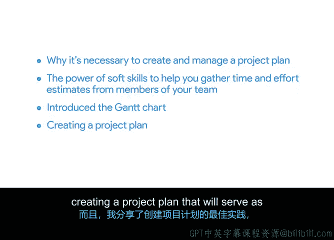

# 谷歌项目管理：专业证书 第3课：《项目规划：将一切整合起来》｜project-planning-google｜ - P19：19_02_01_总结_2.zh_en - GPT中英字幕课程资源 - BV1Y94y1r7gw

Nice work Let's recap what we've just covered。First。

 we took you through why it's necessary to create and manage a project plan at the center of the project plan is a project schedule。

 and we discussed methods for determining realistic time and effort estimates for each task。

You also learn more about the power of soft skills to help you gather time and effort estimates from members of your team We also introduced you to a Ganttup。

 which is a useful tool for visualizing a project schedule。

 and I shared my best practices for creating a project plan that will serve as a useful source of information throughout the planning phase and execution phase。

Coming up， we'll take you through managing costs and budgets， See you soon。

