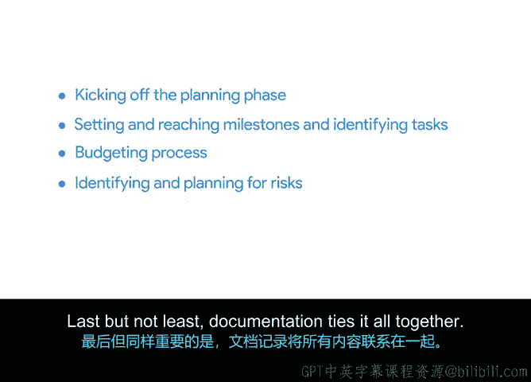

# 谷歌项目管理：专业证书 第3课：《项目规划：将一切整合起来》｜project-planning-google｜ - P1：01_01_01_课程三简介.zh_en - GPT中英字幕课程资源 - BV1Y94y1r7gw

🎼Hello， welcome to this course called Planning， Puing it all together。

🎼If you've already completed our previous courses， then you have a great foundation for what it takes to initiate a project and kick off the planning phase。

🎼Before we get started， let me introduce myself My name is Roweena and I'll be your instructor for this course。

I work as a senior program manager in Google Cloud on a variety of projects。

 I mostly focus on systems and productivity enhancements for my team。

 which consists of around 100 full- time employees and more than 300 contractors around the world。

 Some of the larger scale projects that I work on impact Google Cloud sales and global sales support teams。

 which are made up of thousands of people， but I didn't start out building solutions for thousands of people at a global company。

I left school at the age of 17 with no college degree and no real plan。Before Google。

 I worked in retail， hospitality， and even in the airline industry as a crew member。

 When I joined the corporate world， I noticed something。

 The processes were just as messy as the stock roomss of the retail stores where I'd worked。

There was so much room to improve。 I came to realize that every business is complicated and that there's always room to create order。

 So I started thinking about ways to automate my day to day tasks。

 I was emailing ideas to my manager and colleagues working with teams across the company。

 braininstorming solutions to problems， coordinating training for my coworkers and so much more。

 That's when it became clear。 I was project managing。😊。

I transferred into a role focused entirely on program management at Google's headquarters in Mountain View。

 California In my job interview， I focused on examples of how I applied these transferable skills from my previous roles and how I could leverage the knowledge I gained from my experience。

Four years later， I'm here and I'm so excited to be partnering with you on this learning journey。😊。

From the outside， big global companies can seem as though they have it all figured out。

 but there's always room for new processes。 And you likely have the skills and insights from your previous experiences that can be useful。

 So keep going。 You're heading in the right direction。This course is focused on the planning phase。

I'll share the tools and techniques to complete this phase First up。

 I'll demonstrate how to kick off the planning phase。

 then we'll explore the importance of setting and reaching milestones。For every milestone stone。

 there'll be a set of tasks to complete。 So I'll teach you some tips for breaking down and distributing the workload。

 Later， we'll discuss the budget and how the overall budgeting process works。

 We'll learn about people or companies outside of your organization that may play a role in determining the budget。

And we'll discuss the importance of sufficiently documenting your budget。

Then we'll discuss the various risks and the possible impact those risks can have on the project。

Nothing ever goes quite as planned， but risk management is a great way to make sure you know what could go wrong and how you'll address it。

🎼This includes communicating possible risks to your stakeholders， creating a mitigation plan。

 and then keeping an eye on those risks to make sure they don't store your projects。

 Last but not least， documentation ties it all together。 Keep all your project plans。

 documented and organized not only helps you， but it also helps those involved knowing their responsibilities。

 Documentation also provides stakeholders with a window into the development of the project。

🎼It has always been important to the success of my own projects at Google。

 and I'm excited to explore this topic with you。😊，🎼Ready to get started， meet you in the next video。

