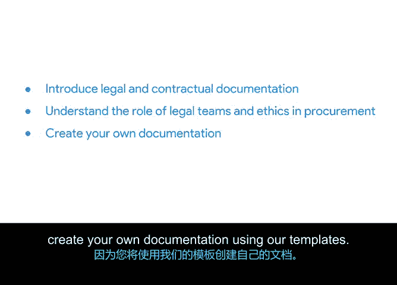

# 谷歌项目管理：专业证书 第3课：《项目规划：将一切整合起来》｜project-planning-google｜ - P20：20_03_01_引言：管理预算与采购.zh_en - GPT中英字幕课程资源 - BV1Y94y1r7gw

Welcome back。🎼Previously， we learned about creating and managing a project plan and using time estimation to prevent project failure。

🎼Coming up， we're going to shift the discussion to the inner workings of a project budget。

🎼So let's discuss money。🎼As mentioned before， a lot of project management skills may overlap with common skills that you already use in your everyday life。

😊，And you may already have some kind of budgeting experience。

Budgeting in the project management world is a complex process involving many different parties and documentation。

I'm going to teach you how to create and manage a real world project budget。

We'll discuss the many components of a budget and how stakeholders play a role in the budgeting process。

You'll learn about the importance of procurement in project management if you don't know what that means yet。

 sit tight， you'll understand that concept soon enough。

 you'll also learn about vendor management and procurement in both the agile and the traditional methodology settings。

There will be several new concepts around legal and contractual documentation introduced throughout。

 such as NDs， RFP and S O Ws。You'll learn that project managers are fluent in acronyms。

 and soon you will be to。 I will explain each of these acronyms coming up。

 We'll also teach you about the role that legal teams and ethics play in procurement。

 I'll give you a hint。 It's a big one。 Start a new project and sourcing materials and vendors without considering the ethical implications can get project managers into hot water。

🎼So you'll learn more about legal teams and ethics to help you avoid these tricky situations The best part。

 you'll get pretty hands on here since you'll create your own documentation using our templates Are you ready We'll get started in the next video。

😊。

