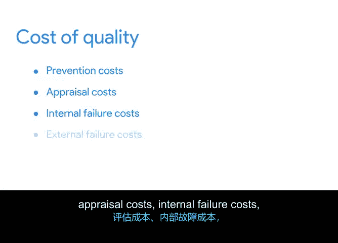

# 谷歌项目管理：专业证书 第3课：《项目规划：将一切整合起来》｜project-planning-google｜ - P22：22_03_03_项目预算的关键组成部分.zh_en - GPT中英字幕课程资源 - BV1Y94y1r7gw

Now that you have an understanding of what a budget is。

 let's discuss some specific components in a budget。

There are so many things to factor into project budgeting。 Unfortunately。

 it's not quite as simple as a company saying we have $5000。 said that's our budget。

 When you go to the grocery store in the same way that you don't determine how much apples will cost。

 Businesses can't just decide that they want to spend $200 on a project if the market rate for a project of the same caliber is $2000。

 Instead， project managers must account for understanding stakeholder needs。

 Budgeting for surplus expenses Main adaptability and reviewing and refocasting throughout the entire project。

And these are only some examples of what you'll need to take into account。

Let's imagine some of these factors in our office screen project。

 in terms of understanding stakeholder needs， it's important to know exactly what stakeholders expect from this project in order to deliver as a company。

 The ultimate goal is typically to make a profit and to save money in time。 So the project sponsor。

 the director of product In this case。 needs the project to come in at a certain cost in order to make profit。

As the project manager， you will also need to budget for surprise expenses。

 Let's say several planters arrive from the vendor， broken and cracked。

 Maybe the plant is cracked during delivery process， and it isn't the vendor's fault。In that case。

 you'll have to order some additional planters to  fulfill orders， and that may be an added cost。

As your project continues along， you'll have to review your budget and sometimes refocast。

 which means creating a separate revised budget based on how your project is tracking。

Keeping on top of the budget will help you stay organized and re forecastcasting is a way to recalibrate the budget if necessary。

 As the project manager office screen， you might find that you need to shift costs to different resources and categories within your project budget。

Maybe you initially overestimated the cost of plants from the vendor and underestimated the costs of marketing your new launch。

 so you can reallocate these dollars as necessary。That's a great example of how to review and refocast。

😊，There are several factors to consider when creating a budget， including resource cost rates。

 reserve analysis， contingency budget and cost of quality。

You'll need to determine resource cost rates。 Re cost rates are exactly what they sound like。

 the cost of a resource。Some examples of resources are labor， tools， equipment。

 materials and software。 So you'll want to ask yourself。

 how much will each of these resources cost the company。

 Sometimes a project can be derailed because a project manager didn't adequately include funds for reserves or buffers。

 Perform a reserve analysis will help you account for any buffer funds you may need。

 A reserve analysis is a method to check for remaining project resources。

In performing a reserve analysis， you'll review all potential risks to your project and determine if you need to add buffer funds。

These funds are necessary because new costs that you didn't originally foresee will arise。

This is also known as contingency budget。 contingency budget in the context of project management is money that is included to cover potentially unforeseen events that aren't accounted for in a cost estimate。

The purpose is to compensate for the uncertainty that occurs in cost and time estimates。

 as well as unpredictable risk exposure。The cost of quality refers to all of the costs that are incurred to prevent issues with products。

 processes or tasks。The cost of quality includes prevention costs， appraisal costs。

 internal failure costs and external failure costs。

Once you've applied these factors， resource cost rates， reserve analysis， contingency budget。

 and the cost of quality into your budget， you can estimate what your project might cost。Remember。

 your budget will most likely change。 Starting with an initial estimate is one way to ensure that you are at least on track。

And it's okay if your budget does change， that's why we review and refocast。Hopefully。

 you're starting to notice the framework for creating a budget。 In the next lesson。

 we'll begin to piece a budget together。Let's put all of your notes and newly acquired knowledge to use。

 See you soon。