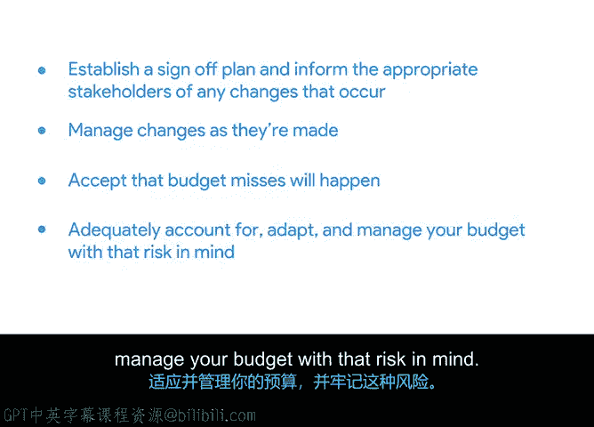

# 谷歌项目管理：专业证书 第3课：《项目规划：将一切整合起来》｜project-planning-google｜ - P24：24_03_03_维护项目预算.zh_en - GPT中英字幕课程资源 - BV1Y94y1r7gw

Now that you have an idea of how to create a budget。

 we're going to discuss how you'll manage that budget and explore some challenges that you might face。

 like being under or over budget。As mentioned previously。

 you'll want to check in on your budget regularly。But what exactly does that mean。

 What are you checking for， How can you tell if you're staying within your budget or not。

 Moning the budget is crucial for a project manager to enforce accountability in terms of spending。

By monitoring your budget regularly， you'll be able to tell if the plans you set into action are actually being implemented on both a financial and operational level。

As you may recall from previous video， a milestone is an important point within the project schedule that indicates progress and usually signifies the completion of a deliverable or phase of the project。

 Miles are a metric for tracking progress in the project。

 Miles are a great opportunity to re review the budget to identify if anything needs to be reset or revisited throughout the project。

 That said， Mis can act as a checkpoint for budget management and payment。😊。

You may have agreed in your contract that you get paid at certain milestones rather than at the end of the project。

 fixeded contracts are usually paid for when certain milestones are reached。

 whereas time and materials， contracts are usually paid for monthly based on the hours worked and other fees associated with the work like travel and meals as you monitor your budget。

 you'll want to be on top of cost control。Cost control is a practice where a project manager identifies factors that might impact their budget and then creates effective actions to minimize variances。

Think of it this way。 It's proactive budget management。

 It is much better to be proactive with your budget than to be reactive with your budget。

If you are reacting instead of anticipating， then you may already have some kind of problem with the budget。

In order to control costs， you should establish a sign off plan and inform the appropriate stakeholders of any changes that occur。

You'll have to ask yourself which stakeholders or sponsor will be approving the contractor or vendor time sheets What about invoices。

 You'll also need to make sure any changes within the project budget are agreed upon， for example。

 you shouldn't approve a new cost or item if it hasn't been agreed upon or if it isn't within the scope and you shouldn't be spending money if it's not preapproved by your stakeholder or project sponsor。

It is also important to make sure there's good business case before bringing it to the stakeholder。

 You'll also need to manage changes as they're made。

 This involves updating forecasts or estimates and tracking everything。

 You never want to be surprised by budget changes。 And you don't want to have to keep asking stakeholders for more money。

 You can prevent that by revisiting these numbers on a regular basis。

 You'll also want to accept that budget misses will happen。

 It's your job to bring the expected cost overruns within acceptable limits。

Before the project starts， collaborate with the project sponsors and key stakeholders to determine an acceptable limit。

 Is it 1 per，10%， you'll decide together in a previous video。

 we talked briefly about what happens when a project goes over or under budget。

Having a project go over budget may mean that the company will have less funds for other areas within the business。

 So let's dig a little deeper into the effects on a company when a project goes under budget。

 even though it seems like going under budget would be a project manager's dream， It actually isn't。

If you go under budget， it's an indicator of less than satisfactory project management。

Going under budget indicates that you may not have done a good job at initially estimating going under budget could also indicate that you could have spent more money on the project。

 meaning that you could have possibly had extra resources or better quality output。

And it may mean that the budget for future projects will be slashed。

The company may figure that since you did this project under budget。

 you'll be able to do future projects under budget， too。

 So that's not a totally desirable situation to be in eitherva。

 The best option is to adequately account for， adapt and manage your budget with that risk in mind。

Later on， we'll cover other strategies more in depth that you could use to save the company money and time。

You will also learn the ins and outs of identifying and managing risks a little later on in the course。

In the next lesson， we'll learn about procurement。 See you in a bit。

