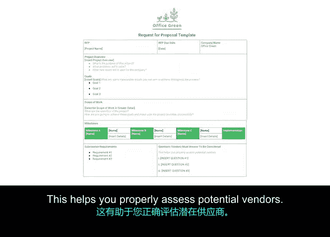

# 谷歌项目管理：专业证书 第3课：《项目规划：将一切整合起来》｜project-planning-google｜ - P27：27_03_04_常见采购文件.zh_en - GPT中英字幕课程资源 - BV1Y94y1r7gw

There are a few important documents that help a project manager navigate through each phase of procurement。

 for instance， in the initiating phase a project manager will create a nondiclosure agreement。

 otherwise known as an NDA。In a selecting phase， a project manager creates a request for proposal or an RFP。

In the contracting phase， a statement of work or an SOW is created。Now。

 let's learn more about these acronyms and documents。

 The first important document is a non disclosure agreement， also known as an N D A。

NDAs are standard within a lot of companies and it's best practice to ask external contract workers to sign an NA。

 the purpose of an NA is to keep confidential information within the organization。So， for instance。

 if a company is using some kind of proprietary technology on a project or preparing for a sensitive product launch。

 they want to ensure that any conversations or information surrounding that technology doesn't leak out to competitors or to the public before the company is ready to launch。

 For example， in project plant Ps， vendors might be required to sign an NA because the project is new to market and hasn't been made public yet。

Then we have a request for a proposal or an RFP， a document that outlines the details and requirements of an organization's project to be passed on to vendors。

 RFps are used to solicit bids from vendors so that you can then select which vendor might be the best for your project。

 A RFP is widely used within different departments in a company and across various industries。

 an RFP typically includes an overview of the project， the desired outcomes and goals。

 budget deadlines， milestones and contact information。

 so each vendor can get back to you with a detailed proposal of how they plan to tackle the job。

 When creating an RFP， make sure to add the following headers to your document。The overview。

Treat this section like a general summary。 What is the purpose of this project。

 What problems will it solve， What new doors will it open for the company。Your goals。

What are some measurable results you can aim to achieve throughout the process？

Next is the scope of work。What are the specifics of the project。

 How are you going to achieve those goals and make sure the project launches successfully。

Then include milestones。Make sure to highlight the key milestones your project will include。Lastly。

 include submission requirements like please submit the RFP as a presentation and include three prototypes as well as the questions you'd like the vendor to answer as part of the process。

This helps you properly assess potential vendors。 For instance。

 you might want to know what issues a contractor sees up front or how the costs will break down。

After the RFP is sent out， various vendors will review it。

 and if they feel they can  fulfill your project's needs， they'll provide a proposal。For example。

 you may create an RFP for project plant powers to source plant providers。In this case。

 you'll want to send out RFPs to all possible plant providers to ensure that you're getting the best price。

 quality and overall value。 You may hear RFP being used as a verb， As in has this been RFP yet。

 That's really a way of asking if an RFP has been sent out to vendors yet。

It's important to note that both the NA and the RFP are fixed and remain the same throughout the process。

This means that there's not a lot of room for customization and it won't be changed once it's submitted。

Lastly， there's a third important document called a statementment of Work or an S O W。

An SOW is sent after the vendor is selected and evolve as the project goes on。😊。

We'll continue discussing these concepts and further explore the importance of a statement of work in the next video。

 I'll see you there。