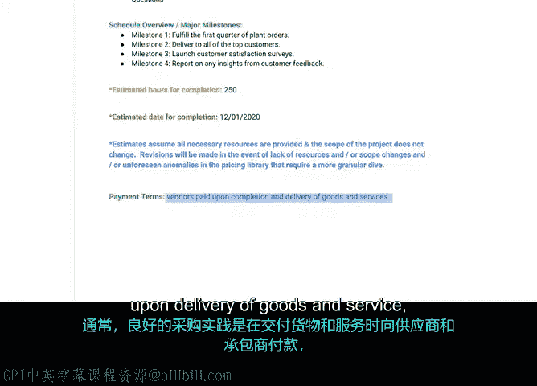

# 谷歌项目管理：专业证书 第3课：《项目规划：将一切整合起来》｜project-planning-google｜ - P28：28_03_05_创建工作说明书.zh_en - GPT中英字幕课程资源 - BV1Y94y1r7gw

Let's continue learning about the necessary documents required for a successful project。

After you've sent a request for proposal to clients and you've selected the vendor。

 client or contractor you want to work with， you'll also send them an SOW or a statement of work。

 A statement of work is a document that clearly lays out the products and services a vendor or contractor will provide for the organization。

 an SOW also provides a description of the contractor's needs and requirements to properly perform the agreed upon services。

Although the SOW covers the customer's needs， it's equally as important to include the organization's needs and the vendor's needs too。

It's critical that all parties involved understand what is expected from each of them in order to deliver the best possible products or services。

The project manager is tasked with developing the SOW。

 but often asks for input from subject matter experts or SMEs for technical expertise that the project manager may not have。

Your organization's legal advisors will review this document with you and may even be crafting it alongside you。

Let's discuss how to create an SOW in the example of project plant powers。

You'll want to start by including page headers with your company name， project。

 and creation date on them。At the top of the page， make sure to include important stakeholders like yourself as the project manager and the name of the sponsor。

 which in this case is the director of product。Next， you'll construct a table for revisions。

The S O W will likely go through a few rounds of revisions。

 because several stakeholders may review it and suggest changes。

 You'll detail those changes in this box here。Next， you'll create a purpose section。

Where you'll go into detail about exactly what the desired outcomes are。

Make sure to include a section regarding your target audience and make sure it's inclusive of everyone。

For instance， in this case， the purpose of the project is to launch a new service that provides desk plans to offices and commercial businesses。

If you have more specific goals， you can list them here， too。

Next is the scope section where you'll include what the service entails。

You may write that the service includes providing customers with small。

 low maintenance plants that they can place on their desks。

Customers can order plants online or from a print catalogue。

 Off screen will ship the plants to the customer's work address。

 The types of plants in scope include 6" leafy ferns， small cacti and 5" Bonsai trees。

 Keep the fender in mind。 Some major activities may be Storing the plants in a warehouse。

Maintaining the health of the plants by providing them with water and light。

 sourcing the vases and ensuring that the vases are in near perfect condition upon delivery。

You'll also want to mention what's out of scope or in other words， what the project doesn't include。

This will eliminate any potential room for confusion and help set expectations with the vendor。

For instance， you may write that the project doesn't include annual reporting or custom plan orders that are not mentioned in the scope。

This helps draw clear lines and sets the right expectations with the vendor。For deliverables。

 you'll want a concise statement about what your project will deliver。For example。

 your Office Green project deliverables could include the vendor providing maintenance guides on how to take care of the plants。

 or that the vendor will be responsible for developing a support page on Office Green's website to address any questions or concerns。

Since milestones are such an integral part of tracking progress， budget and scope。

 they'll need to be included here too。Examples of milestones in project plant powers could be to fulfil the first quarter of plant orders deliver to all of the top customers。

 launch customer satisfaction surveys， collect and report on any insights from customer feedback。

You'll want to make it really clear on how many hours are needed for the completion of this project here。

 and you will want to designate a particular date that you need their services performed by here。

At the bottom， you'll typically add terms and conditions and any other disclaimers。

 It's good to have a disclaimer stating that revisions may take place as the project goes on。

 This is important to include just in case the scope changes because of unforeseen issues。

It's a good idea to add revisions into the disclaimer， because as a project manager。

 it's best not to over promiseise and under deliverli。

 You always want to be clear that you intend to stick to the schedule unless circumstances outside of your control intervene。

Another part of your S。 O W is payment terms。 This outlines when your suppliers need to be paid。

 Enuring that suppliers are paid on time will promote strong relationships。Generally。

 good procurement practice would be to pay your vendors and contractors upon delivery of goods and service。

 not before， unless a circumstantial agreement has been made。 For instance。

 if Office Green's plant provider requested to be paid when each milestone was completed instead of after the entire project is finished。

Great job。 Now you know more about S OWs。 Next up， we'll discuss the importance of partnering with your legal team during the procurement process。

 See you there。