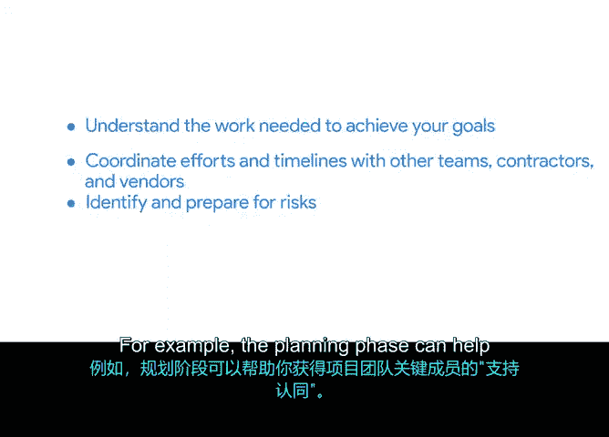

# 谷歌项目管理：专业证书 第3课：《项目规划：将一切整合起来》｜project-planning-google｜ - P2：02_01_01_项目规划的优势.zh_en - GPT中英字幕课程资源 - BV1Y94y1r7gw

H again。In the previous course， you learned about the initiation phase during the initiation phase。

 the project manager is gathering all of the necessary preliminary information needed to get stakeholder approval and plan the project。

 A few key things need to happen during this time。 First， the project manager gets assigned。

 That's you。 Then the goals of the project have to be approved。

 as well as the scope of the project and its deliverables。

 A number of people will need to be assigned to the project。

 And you'll have a good sense of their individual roles and responsibilities。

 You'll also need stakeholder sign off on your project charter。

If all of these criteria have been met， then you're set to begin planning。

Planning is a significant part of ensuring a project success。

So let's take some time to discuss why it's so important。Planning is important for any project。

 large or small。While planning your project， you and other members of the team will determine the processes and workflows needed to meet your goals and put together ideas about how to make the project a success。

While planning， you might draw from previous project experience。

 but don't be afraid to think of new ways to get results。Every project is different。

 So new and different approaches may be just the thing you need。 Planning has many benefits。

 As we've discussed， Plan helps you map out the full project。

 It helps you understand the work needed to achieve your goals。

 Planning also helps coordinate efforts and timelines with other teams， contractors and vendors。

 Another huge benefit of planning is that it gives you time to identify and prepare for risks that could impact your project。

 Those might include things like a delay in the timeline。

 The departure of a critical team member or a change in project direction from a primary stakeholder。

Planning also gives you the chance to brainstorm ways to mitigate or address those risks。

 There are less obvious benefits， too。 For example。

 the planning phase can help you get buy in from key members of the project team。

 Getting buy in means that you've gained their support for your plans。

Planning also demonstrates to stakeholders that the team is taking care to start the project with a detailed plan。

But one of the most significant benefits of planning is teamwork。

 which will help you push your project across the finish line by working together in the planning phase。

  individuals assigned to the project can become a strong team by the time the planning is done and the work is about to start。

 Plan together creates a shared understanding among all parties involved in the project。

 So to recap planning as many benefits from helping the team to understand the work needed to achieve their goals to providing project plans to the stakeholders。

😊，Now that you know a bit more about planning， we'll learn how to launch the planning phase。

 Me you in the next video。