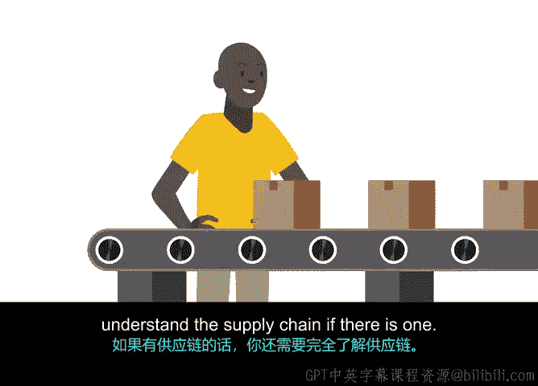

# 谷歌项目管理：专业证书 第3课：《项目规划：将一切整合起来》｜project-planning-google｜ - P30：30_03_02_采购流程中的伦理规范.zh_en - GPT中英字幕课程资源 - BV1Y94y1r7gw

Welcome back。We've learned a bit about the ins and outs of contracting with vendors。

 so let's learn more about the importance of ethics when partnering with vendors。

Failing to be mindful when choosing vendors can lead to significant consequences。

If you've seen a company in the news that's been entangled in a scandal。

 that usually means that the team probably should have done more research in the procurement process。

 So what does that entail。There's a lot that can be done to ensure that businesses are operating in an ethical way。

Project managers have a big job when deciphering whether or not every aspect of their project is sourced ethically。

 It helps if the project manager thoroughly oversees the project to make sure the safety。

 economic and environmental ethical risks are mitigated。 In other words， doing a lot of research。

 monitoring and evaluating throughout the project is a project manager's job。

There are a couple of steps to safeguard ethical procurement。

 The first is knowing your business's legal requirements。

You'll want to have a deep understanding of what is required of you legally as a project manager。

 for your business。 You can also seek out the code of ethics for your profession。

Which in this case is for project managers。For instance， the Project Management Institute。

 also known as PMI， has a code of ethics that you can access as a member or credential holder。

This will help you understand some parameters for how to assess ethical versus unethical procurement。

 According to the PMI's code of ethics， honesty， responsibility。

 respect and fairness are the values that drive ethical conduct for the project management profession。

 So when you become a project manager。 If you aren't totally sure if something is ethical。 First。

 try to use your best judgment based on what you believe those words mean and continue to do the required research if you still aren't sure。

 don't hesitate to ask a subject matter expert such as someone from the legal team as a starting point。

 some unethical issues or risks you may run into may include bribery or corruption。

Some regulations in other countries may not be the same as regulations in your country。 So。

 for example， you'll want to make sure labourers involved in production are treated fairly。

 working in good conditions and are compensated adequately for their work。

It is a good idea to consult your legal team to ensure that you don't run into these situations and to be aware of the regulations surrounding your processes。

 Youll also want to be aware of possible issues with soulle supplier sourcing。In some scenarios。

 you may need to perform noncompetitive procurement。

 which is when a company restricts the bidding process to one supplier。

 This may be common for companies who are more cautious about exposing trade secrets。

 But regardless of your reasoning， you'll need to be able to justify exactly why you are choosing to restrict bidding to one supplier。

There's also interaction with state owned entities。

You'll want to be vigilant when dealing with government agencies and officials。

Government agencies may have tighter restrictions in regulations in regard to sourcing。

 and you don't want to do anything unethical without even knowing it。

 A project manager monitors the project's ethics throughout the whole process。

In the initiating phase， you'll need to decide whether the project is ethical in the first place。

Does it meet your business's code of ethics？ Does the project meet environmental ethics laid out by governmental agencies。

 I the Labour going to be ethically sourced？You'll need to review government regulations and policies。

 assess potential risks and put together a diverse team that you trust to be ethical before the contracts are signed。

 you'll want to figure out whether the suppliers you're thinking of hiring are ethical。

 you'll want to make sure that your're procuring them in an ethical way and are paying them a fair rate。

 and you'll also want to completely understand the supply chain if there is one after the contracts have been signed by your contractors。

 make sure to carry out your assurance duties。 This may include things like auditing each task and cost。

 executing quality control or even approving invoices during the production of your service or product。

 focus on the day to day relationships with vendors to make sure they're aware of and meeting your deliverables and keeping you informed of any potential roadbox。

 after you' have done all the research that you possibly can on whether your project is ethical。

 remember to trust yourself。 If something feels wrong， it probably is。 As you know。

There's a lot to keep track of as a project manager by keeping these ethical principles in mind as you begin your project。

 you'll save yourself and the company from a lot of headaches later on。 Of course。

 you can usually go to your legal team or key stakeholders if you ever have a question or need a second opinion In the next video。

 We're going to review and wrap up everything we've just covered I'll see you there。

